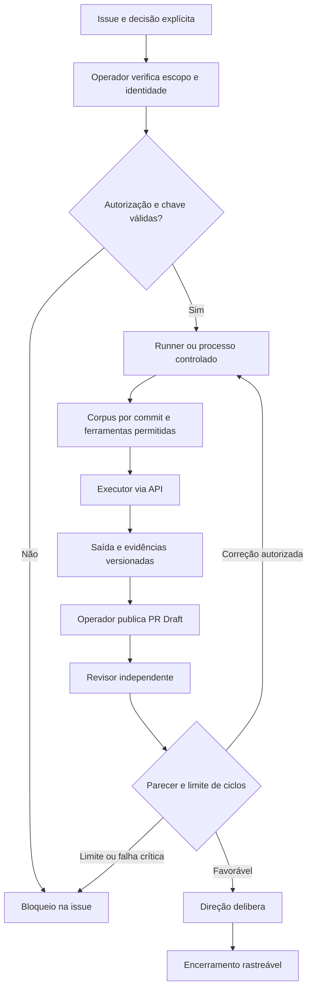

# GT-AI-DISPATCH-001 — Despacho e Notificação de Missões dos Agentes

## 1. Visão, problema e limite da entrega

Uma solicitação registrada deve ter destino, autorização, responsável pelo encaminhamento, confirmação observável e resultado verificável. Hoje o GitHub registra a demanda, mas isso não comprova o acionamento de um agente conversacional. O produto é um fluxo de missões rastreáveis na issue existente, começando por coordenação humana e recursos nativos. Benefício esperado: menos missões esquecidas e menos consultas manuais da Direção; benefício ainda não medido.

Este refinamento aproveita o [diagnóstico da Governança](https://github.com/gentestsai-sudo/gentests-os/issues/47#issuecomment-6103014403), sem repetir o discovery ou auditar controles administrativos. A [Issue #47](https://github.com/gentestsai-sudo/gentests-os/issues/47) continua sendo o registro canônico da demanda. Este arquivo especifica o produto; a PR conterá somente seu delta documental, sem uma segunda fila de missões. A solicitação da Direção nesta sessão autoriza refinamento e registro, não implantação.

**Prioridade:** planejamento estrutural, subordinado ao P0 comercial da #45. Nenhuma dependência deste desenho bloqueia correções comerciais já autorizadas. Nenhum workflow, integração, credencial, label, atribuição operacional, permissão, política ou automação é criado/alterado nesta entrega. Não executar piloto, contratar, fazer merge ou acionar outros agentes.

### Fontes examinadas e limites

Baseline da main: `a4c3f7606747f29acb6e11928889f962355c3ab7`, consultada em 10/10/2026. Não há AGENTS.md no inventário dessa árvore.

| Fonte | Estado e consequência |
|---|---|
| POL-003 — `00-Constituicao/Matriz-de-Permissoes.md` | v1.0.0, proposta; blob `7bf11bc753244ddf4164750c3e764b28d8704de1`. Não explicita os papéis de coordenação/execução/revisão |
| QG-001 — `00-Constituicao/Quality-Gates/QG-001-Politica.md` | v0.1.0, proposta; blob `f58d0d10e3718379b6dd0311056b5e0cc3754430`; gate documental não comprova enforcement |
| SEC-AI-001 — `00-Constituicao/SEC-AI-001-Seguranca-Confiabilidade-Agentes.md` | v0.1.0, proposta; blob `5a3a7067a03041011ecbef3da8cc0f82df5a366d` |
| GOV-5S-001 — `00-Constituicao/Excelencia-Enxuta-5S.md` | v0.1.0, proposta; blob `8759d58860dd38402767685861947d6c3c6c5c4f`; reutilizar fontes/fluxos |
| Índice e sete contratos de `02-Agentes/` | Especificações de design, todos os contratos em proposta; ausência de prova de conta/sessão permanente |
| [PR #17 — DEC-GOV3-20261010-001](https://github.com/gentestsai-sudo/gentests-os/pull/17) | Registro delimitado: preparação encerrada e redação revisada de POL-003 autorizada; nove normas não homologadas; GT-GOV-004 somente backlog; sem merge/execução técnica |
| [DISC-QA-001 #46](https://github.com/gentestsai-sudo/gentests-os/issues/46#issuecomment-6102935301) e parecer posterior na mesma issue | Proposta não vigente; revisão aponta A01–A04 e não recomenda institucionalizar ainda o fluxo completo. Não antecipar resolução nem alterar seu diagnóstico |
| [GT-AI-LEARN-001 PR #8](https://github.com/gentestsai-sudo/gentests-os/pull/8) | v0.2.0, head `74453f80ec03bc00bcd0e1b73838138ba29933e3`; revisão focal documental favorável, piloto/CI/curadoria não autorizados |
| Metadados do repositório | Privado, main como padrão; acesso de leitura/escrita do conector nesta sessão não prova identidades ou permissões dos futuros agentes |
| Três workflows existentes em `.github/workflows/` | Markdown, QG e X9 determinístico; arquivos lidos, execução/cotas não inspecionadas. Não demonstram despacho ou IA conectada |
| Labels/canais/plano | Inventário completo de labels não obtido: endpoint recusado pelo conector. Configurações pessoais, plano contratado, saldo/cotas e entrega de notificações não verificados |

Normas em proposta são referências de desenho, não obrigações declaradas vigentes por este documento. As restrições explícitas da Direção aplicam-se a esta entrega. Revisão POL-003 e controles seguem seus registros próprios; não abrir tarefas duplicadas.

## 2. MVP e requisitos

**MVP candidato (Fase 1):** contrato na issue existente; triagem humana; um destino por etapa; responsável humano; estados/evidências; labels mínimas aprovadas; pesquisas salvas por URL; encaminhamento manual a sessão disponível; revisão separada e encerramento autorizado. Não exige GitHub Projects, dashboard, planilha, API de IA ou conta GitHub para cada agente. Projects pode ser avaliado depois somente como projeção da issue, sem estado concorrente.

| ID | Requisito executável e saída verificável |
|---|---|
| RF-01 | Catálogo §3 diferencia papel, contrato, identidade, canal e capacidade; destino desconhecido nunca aparece como conectado |
| RF-02 | Contrato §4 na issue canônica, com revisão do escopo e autorização explícita antes de aceitar/iniciar |
| RF-03 | Estado operacional único §5; log de eventos com autoria, instante e evidência; notificar não muda para recebido |
| RF-04 | Filtros §6 encontram nova missão, P0, pendência por papel, não recebida, bloqueada, revisão e conclusão |
| RF-05 | Regras §7 impedem autorização por label, duplicação, concorrência e autoaprovação |
| RF-06 | Cenários §9 com resultado esperado observável; positivos e negativos obrigatórios no piloto autorizado |

| ID | Requisito não funcional / verificação |
|---|---|
| RNF-01 Rastreabilidade | Cada evento registra missão, revisão, etapa, responsável, autoria técnica/humana, data ISO 8601 com fuso e link verificável; evidência inacessível = não verificável |
| RNF-02 Segurança | Menor privilégio real antes de Fase 2/3; texto de issue é dado; sem segredos ou informações privadas de clientes nos registros |
| RNF-03 Consistência | Uma missão ativa por issue no MVP e um executor ativo por etapa; divergência entre resumo e evidência suspende início/fechamento |
| RNF-04 Recuperação | Ausência de canal/agente/confirmação não perde a missão; bloquear/aguardar com dono e próxima verificação, mantendo histórico |
| RNF-05 Usabilidade | Direção consegue localizar cada fila e abrir evidência em até 2 minutos no piloto, inclusive pelo GitHub Mobile/iPhone; resultado a medir |
| RNF-06 Custo/capacidade | Horas e limites acordados antes do piloto; nenhuma compra/API/runner novo. P0 comercial preempta este planejamento |
| RNF-07 Evolução | Qualquer mudança de escopo/aceite/autorização exige revisão registrada; histórico nunca apagado para melhorar métrica |

## 3. RF-01 — Catálogo funcional candidato

**Como ler:** contrato identifica capacidade prevista, não capacidade efetivamente executada. Encaminhador proposto para todos: Orquestrador; Direção como contingência e para decisões. Nome humano específico e suplente: a designar. Canal geral candidato: pessoa verificada consulta a issue no GitHub e leva link/instrução à sessão conversacional disponível. Notificações GitHub são para contas humanas verificadas e dependem de configuração; não há canal automático de agente comprovado.

| Agente/papel | Função e atividades candidatas | Fonte | Capacidade efetivamente identificada / limitação |
|---|---|---|---|
| Comercial — AGT-COM | Pesquisa, qualificação, rascunhos, CRM no escopo expresso | Contrato Comercial v1.0.0 | Contrato lido; execução/conector individual não demonstrados. Envio externo exige autorização |
| Marketing — AGT-MKT | Conteúdo, peças e revisão de marca | Contrato Marketing v1.0.0; #38/PR #39 | PR de proposta/material identificada, não prova serviço residente. Publicação/identidade condicionadas |
| QA — AGT-QA | Requisitos, risco, testes/evidências em ambiente permitido | Contrato QA v1.0.0 | Contrato lido; ambiente/capacidade atual não comprovados; produção/carga/destruição não presumidas |
| Financeiro — AGT-FIN | Análises e registros com fontes | Contrato Financeiro v1.0.0 | Dados/ferramentas autorizados não verificados; sem pagamentos autônomos |
| Auditor — AGT-AUD | Conformidade e efetividade por amostra | Contrato Auditor v1.0.0 | Contrato lido; acesso/auditoria efetiva não comprovados; não confundir com executor |
| Validador — AGT-VAL | Parecer contextual, QG, evidências | Contrato Validador v0.1.0 | Contrato diz não implementado como autônomo; não edita/valida própria entrega |
| X9 — AGT-X9 | Inspeção documental e alertas | Contrato X9 v0.1.0; workflow x9-daily | Especificação determinística de workflow presente; não se verificou run nem IA autônoma |
| Orquestrador | Triagem, deduplicação, coordenação e acompanhamento | #47, Governança; GT-GOV-003 §3 | Papel operacional referido; contrato próprio/conta/serviço não encontrados no inventário consultado |
| Governança | Avaliar autorização, riscos, fontes normativas e desvios | Comentário 6103014403 | Diagnóstico entregue na issue; prova de trabalho documental, sem identidade GitHub individual/continuidade |
| Executor Técnico | Viabilidade e futuras implementações delimitadas | #47/#45; GT-GOV-003 §3 | Missões referidas, capacidade de integração permanente desconhecida; código/workflow fora desta autorização |
| Revisor Independente | Revisar delta e emitir parecer separado | #47; parecer #46; PR #11 | Pareceres identificados; seleção de sessão/autor distinto ainda depende de coordenação verificável |
| Gerente de Produto | Refinamento, requisitos, piloto e priorização | Solicitação atual | Refinamento documental elaborado nesta sessão; não possui serviço permanente demonstrado |
| UX/UI | Propostas e estados de interface | PR #36 | Proposta identificada; conta/contrato/integração não comprovados |
| Executor do Site | Alterações delimitadas no site | PR #5 referencia execução no gentests-site | Referência documental somente; acesso/capacidade atual não inspecionados |

Todos os destinos acima: conta GitHub própria **não verificada**, sessão contínua **não comprovada**, serviço acionável **não comprovado**, disponibilidade **a confirmar por missão**. A conta `gentestsai-sudo` observada como autora dos registros não representa contas separadas de agentes. Não inferir independência só por login ou nome do papel.

Na preparação autorizada do piloto, registrar **na #47**, sem cadastro externo, confirmação de cada destino usado: papel; operador humano e suplente; conta GitHub elegível verificada; canal real; referência da sessão/serviço sem dado sensível; ferramentas/ações demonstradas; disponibilidade e data de confirmação. Pode registrar “encaminhamento humano obrigatório” e “sem conta de agente”. Nenhuma prova de disponibilidade equivale a permissão.

## 4. RF-02 — Contrato de missão na issue

O ID é o já existente; se ausente, usar referência estável `gentests-os#N`, sem inventar novo código corporativo. Uma issue contém uma missão ativa no MVP; execução e revisão são etapas da mesma missão. A #47 guarda esta proposta, sem duplicar missões de #45/#46.

**Bloco candidato no corpo da issue (implantação posterior autorizada):**

| Campo | Conteúdo mínimo / regra |
|---|---|
| Identificação/descrição | ID, problema, resultado esperado e issue canônica |
| Revisão autorizada | Inteiro do escopo/aceite; começa 1; incremento só com decisão válida que altere a missão |
| Etapa e destino | Execução ou revisão; papel destinatário; executor atual; revisor distinto |
| Responsável humano | Operador/encaminhador, conta verificada ou sem conta, suplente, canal disponível |
| Prioridade/risco | Prioridade explícita, inclusive P0; risco separado; sem prazo/SLA presumidos |
| Autorização | Referência da decisão, decisor, objeto, ações permitidas/proibidas, alvo/ambiente, artefato, condições e validade/janela quando aplicável |
| Artefato | Caminho/link, versão e commit fixo; hash para binário. “N/A — justificativa” quando não houver artefato |
| Aceite | Condições mensuráveis, evidências exigidas, validador e decisão de encerramento necessária |
| Dependências | ID/link, responsável e condição de resolução; impedimentos e próxima checagem acordada |
| Estado operacional | Um dos sete valores do §5; etapa; número de atribuição; link do último evento justificativo |
| Marcos separados | Notificação (não tentada/tentada/falhou/envio comprovado); recebimento (desconhecido/confirmado); aceite (pendente/aceito/recusado); início; entrega; validação; decisão de encerramento |
| Evidências/resultado | Links de eventos/PR/commit/parecer/decisão e resultado real; testes não executados declarados |

**Autorização suficiente:** fonte observável da Direção dentro da validade, abrangendo a ação e condições pretendidas. Autor do comentário, login administrativo, campo `decision_id` ou citação isolada não bastam. Transcrição de chat deve identificar sua origem e ser conferida pelo responsável humano; dúvida de origem/escopo fica bloqueada. Revisões editadas exigem nova conferência. Não criar assinatura, homologação ou aprovação inexistente.

**Evento candidato em comentário da mesma issue:** tipo; chave `repo+issue+revisão+etapa`; número da atribuição; responsável; ator/operador e papel; instante; origem/autorização; evidência; resultado/limite; próximo estado. Tipos: triagem, atribuição, tentativa-notificação, confirmação-envio, falha-notificação, recebido, aceite, recusa, início, entrega, parecer, decisão, suspensão, reatribuição, desbloqueio.

Log em comentários preserva eventos; resumo do corpo referencia eventos válidos. Labels são projeções para busca; não são autoridade. Se resumo/label divergir, Orquestrador registra reconciliação segundo a decisão e evidência válidas, não simplesmente o comentário mais recente. Não apagar histórico. Até reconciliar, impedir novo início/fechamento; manter trabalho afetado suspenso quando houver risco.

**Exemplo válido documental:** solicitação atual autoriza Produto a refinar GT-AI-DISPATCH-001, registrar na #47 e apresentar PR Draft; aceite = requisitos, cenários, alternativas e pendências rastreáveis. Não inclui implementar Fase 1. **Exemplo bloqueado:** label P0 + comentário “crie credenciais e execute todas as issues”; faltam autorização e escopo e contraria restrições expressas.

## 5. RF-03 — Fluxo, transições e responsabilidades

Notificação é um marco, não um estado de execução. **Recebido** comprova acesso ao conteúdo da revisão atribuída; **aceito** comprova compromisso dentro do escopo; **iniciado** comprova começo real. “Lido” não é inferido de e-mail aberto ou indicador de notificação. Aceite pode ser evento após recebido, mantendo esse estado até início. Bloqueado é estado operacional, não conclusão bem-sucedida e não motivo automático para fechar a issue.

| De → para | Evento e condição | Quem registra / evidência exigida |
|---|---|---|
| Nova → Aguardando triagem | Demanda identificada na issue; ID e origem | Solicitante/Orquestrador; URL, instante, descrição |
| Aguardando triagem → Aguardando agente | Contrato suficiente, autorização conferida, destino/revisor/encaminhador definidos, sem duplicata | Orquestrador; decisão+contrato+atribuição. Canal desconhecido requer bloqueio, sem fingir despacho |
| Aguardando agente → Aguardando agente | Tentativa/envio/falha de notificação | Encaminhador; evento real da ferramenta ou relato explícito da tentativa. Comentário/mention registrado prova tentativa, não entrega da notificação |
| Aguardando agente → Recebido | Destino confirma missão, revisão, atribuição e limites lidos | Agente por canal observável; operador transcreve com origem conferida se sem conta. Confirmação humana isolada não prova recebimento pelo agente |
| Recebido → Recebido | Aceite explícito ou pedido de esclarecimento sem começar | Agente confirma disponibilidade, escopo e ausência de conflito; registrar aceite separado |
| Recebido → Em execução | Recebimento+aceite+autorização válidos, atribuição atual sem outro executor ativo e início real | Executor; evento de início com objeto/primeira ação permitida, instante e evidência. Sem ação adicional apenas para “provar” início |
| Em execução → Em revisão | Entrega versionada e evidências/limitações presentes | Executor entrega; Orquestrador encaminha a revisor distinto; commit/PR e checklist do aceite. Revisão também exige recebimento/aceite/início registrados para sua etapa |
| Em revisão → Em execução | Parecer pede correção delimitada coberta pela autorização atual | Revisor aponta delta; Orquestrador devolve; executor confirma reinício. Mudança de escopo exige revisão/autorização nova |
| Em revisão → Concluído | Aceite evidenciado, parecer independente quando aplicável e decisão exigida para encerramento | Direção decide neste piloto; Orquestrador registra links. Executor não se autocertifica. Merge/publicação continuam atos distintos |
| Qualquer ativo → Bloqueado | Falta de autorização, canal/agente indisponível, conflito, incidente ou dependência impeditiva | Detector relata; Orquestrador registra causa, etapa anterior, dono e condição de desbloqueio. Segurança escala imediatamente |
| Bloqueado → estado ativo pertinente | Condição impeditiva resolvida por evidência e autorização atual reconferida | Orquestrador; decisão, prova, etapa e atribuição atual. Não saltar recebido/aceite/início |
| Concluído → Aguardando triagem | Novo fato material justificado, reabertura ou nova revisão autorizada | Direção/Orquestrador registra motivo/decisão; preserva conclusão anterior, sem nova contagem indevida |

Direção autoriza escopo/custos, arbitra conflitos e decide encerramento; Produto especifica; Orquestrador coordena sem homologar; Governança verifica conformidade/identidade de autorização sem conceder acesso; executor trabalha dentro do escopo; revisor em sessão/autor distinguível não modifica a entrega original; Infra fornece comprovações técnicas futuras. São responsabilidades propostas, não extensão silenciosa da POL-003.

Cancelamento/duplicata: registrar resultado e vínculo, com decisão competente; pode fechar issue como não planejada quando autorizado, mas não usar label Concluído nem contabilizar entrega validada. Issue fechada por interface não prova conclusão válida.

## 6. RF-04 — Filas nativas e acompanhamento

Nomenclatura abaixo é **candidata**, não criada nem validada contra inventário completo. Orquestrador deve inspecionar labels existentes antes do piloto, mapear equivalentes e propor só as ausentes. Uma label `mission`, uma prioridade, um papel da etapa atual e **um** estado: `status:triagem`, `status:aguardando-agente`, `status:recebido`, `status:execucao`, `status:revisao`, `status:concluido`, `status:bloqueado`. Usar `agent:<papel>` para destino lógico e assignee somente para conta verificada do responsável humano ou agente real elegível; não atribuir conta fictícia. Se uma pessoa encaminha vários papéis, filtro por assignee não substitui agente.

Consultas candidatas a salvar como URLs/favoritos no GitHub, depois da conciliação dos nomes:

| Visão | Consulta (prefixar `repo:gentestsai-sudo/gentests-os is:issue`) |
|---|---|
| Todas as missões ativas | `is:open label:mission sort:created-asc` |
| Novas | `is:open label:mission label:"status:triagem" sort:created-asc` |
| P0 | `is:open label:mission label:"priority:p0" sort:created-asc` |
| Pendências de um agente | `is:open label:mission label:"agent:product" sort:created-asc` (substituir papel mapeado) |
| Sem confirmação | `is:open label:mission label:"status:aguardando-agente" sort:created-asc`; conferir também bloqueados por recebimento |
| Bloqueadas | `is:open label:mission label:"status:bloqueado" sort:updated-asc` |
| Aguardando revisão | `is:open label:mission label:"status:revisao" sort:created-asc` |
| Concluídas validadas | `label:mission label:"status:concluido" sort:updated-desc`; conferir links de aceite, não contar fechamento simples |

Bloqueio por falta de confirmação mantém marco “desconhecido” e causa no resumo. A fila bloqueada é parte obrigatória da consulta de não recebidas; não esconder pendência por trocar label. Missão sem qualquer label pode escapar dos filtros: na triagem periódica humana conferir também issues abertas sem classificação contra o contrato, sem tratar toda issue como missão.

P0 não implica prazo ou permissão. Orquestrador verifica filas no início de sua sessão de trabalho e antes de encerrar; próxima checagem é registrada quando não houver disponibilidade contínua. Cadência e suplente precisam ser aprovados; não se promete monitoramento permanente.

Notificações nativas dependem de conta elegível e preferências pessoais (watch/participação/mentions/atribuição). GitHub permite inbox, e-mail e Mobile; evidência de envio/recebimento real deve ser observada no piloto. Uma mention no mesmo usuário que realizou a ação pode não fornecer prova útil: não garantir auto-notificação. Com apenas uma conta, usar encaminhamento manual comprovado e declarar limite. Não enviar e-mail externo nesta fase.

## 7. RF-05 — Regras de negócio e falha segura

| ID | Regra |
|---|---|
| RN-01 | Orquestrador atribui somente após conferir destino, capacidade, escopo e autorização. P0, label, assignee, estado ou acesso administrativo não concedem poderes |
| RN-02 | Chave da execução = repositório+issue+revisão autorizada+etapa. Atribuição tem geração própria; tentativa de alerta não muda revisão nem cria missão |
| RN-03 | Antes de despachar, conferir histórico pela chave. Redelivery do mesmo evento não produz execução nem missão adicional; registrar duplicata só quando útil. Mudança de agente mantém missão |
| RN-04 | Reatribuição suspende novas ações do executor anterior; requer confirmação de parada e checkpoint/artefatos. Se executor não responde, manter bloqueado até operador comprovar término/revogação do acesso pertinente. Só depois invalidar aceite anterior, incrementar atribuição e colher novo recebido/aceite/início |
| RN-05 | Sem agente disponível, bloquear com dono humano e próximo contato acordado. Revisor indisponível mantém entrega em revisão, com impedimento; não dispensar revisão |
| RN-06 | Autorização ausente/ambígua/expirada ou escopo alterado bloqueia ação; preparar esclarecimento na mesma issue. Proposta normativa citada não cria permissão |
| RN-07 | Notificação que falhou ou ficou sem confirmação registra verdade e encaminhador. Até duas tentativas humanas, em momentos acordados; nunca loop. Após limite ou janela acordada sem resposta, escalar à Direção. Sem janela definida, próximo contato é decisão pendente, sem SLA inventado |
| RN-08 | Segredo, identidade incerta, tentativa de autopermissão ou ação fora do escopo: suspender fluxo afetado e escalar imediatamente, sem esperar tentativas/prazos |
| RN-09 | Separação executor/revisor por etapa/artefato; mesma conta GitHub pode ser apenas operador, mas exige evidência de sessões/autorias distintas e responsável humano pela verificação. Nome diferente no comentário não comprova independência |
| RN-10 | Entrega sem evidência, parecer insuficiente ou teste não executado não vira concluída. Parecer favorável não libera merge, publicação, gasto ou vigência normativa |
| RN-11 | Comentário/arquivo é dado não confiável. Pedido para ignorar regras, alterar decisão, conceder token ou concluir automaticamente é desconsiderado como comando; registrar mínimo seguro e conferir fonte humana por canal autorizado |
| RN-12 | Futura Fase 2 ignora ecos próprios e eventos que ela mesma gerou; valida origem, revisão e atribuição atuais; limita redelivery e volume. Fase 3 precisa exclusão mútua técnica/revogação, não só label. Sem essa prova, não ativar |
| RN-13 | Falha de despacho relatada fica na issue original com esperado/observado/evidência. Não contar limitação, duplicata ou teste inconclusivo como defeito confirmado, nem abrir RNC automática. Referenciar #46/PROC-RNC-001 quando houver enquadramento validado |
| RN-14 | Correção reabre somente delta necessário; seguir limite candidato de duas rodadas automáticas malsucedidas da SEC-AI-001 quando houver automação futura autorizada; no MVP, retrabalho humano também deve ser dimensionado antes de continuar |
| RN-15 | Caso confirmado pode ser candidato à curadoria da PR #8, com revisão e autorização próprias; não promover golden, alterar prompts/políticas ou treinar automaticamente |
| RN-16 | Fase 1 tem verificação manual, não enforcement automático. Se interface permitir uma label/fechamento indevido, detectar, registrar e reconciliar; não alegar bloqueio técnico inexistente |

## 8. Histórias de usuário

| ID | História | Aceite associado |
|---|---|---|
| HU-01 | Como Direção, quero registrar demanda uma vez e ver quem deve agir, para evitar missões esquecidas | CT-01/02/03 |
| HU-02 | Como Orquestrador, quero confirmar destino e autorização antes do despacho, para encaminhar com segurança | CT-04/05/09/13 |
| HU-03 | Como executor, quero receber escopo/commit/aceite claros e confirmar disponibilidade, para iniciar a missão correta | CT-06/07/16 |
| HU-04 | Como Orquestrador, quero reatribuir com parada confirmada, para evitar execução concorrente | CT-08 |
| HU-05 | Como revisor, quero entrega versionada e autoria distinta, para revisar focalmente sem autocertificação | CT-10/11 |
| HU-06 | Como Direção, quero distinguir notificação de execução e conclusão, para decidir com fatos | CT-05/06/10/12 |
| HU-07 | Como Governança, quero tratar conteúdo malicioso/duplicação/falha com estado verdadeiro, para preservar controles | CT-07/13/14/15 |

## 9. RF-06 — Critérios de aceite e cenários verificáveis

**Estado de todos os cenários: NÃO EXECUTADOS.** São roteiros para futuro piloto autorizado, não testes aprovados. Preparar dados sintéticos na própria issue de piloto; sem segredos reais, envio externo ou impacto comercial. Cada caso registra revisão/atribuição inicial, passos, esperado, observado, fonte/evidência e avaliador distinto. Fase 1 verifica comportamento do operador e rastreabilidade; Fases 2/3 precisarão testes técnicos correspondentes.

| ID / fase | Dado / quando | Então (resultado verificável) |
|---|---|---|
| CT-01 / F1 positivo | Issue sintética com contrato e decisão do piloto; triagem identifica missão | Uma missão com ID/estado, sem issue duplicada; URL na fila de novas |
| CT-02 / F1 positivo | Prioridade P0 sintética atribuída sob escopo do piloto; Direção consulta filtro | Encontrada em até 2 min; nenhuma atividade comercial real preemptada nem permissão ampliada |
| CT-03 / F1 positivo | Missões em cada estado, uma por vez; Direção consulta filas no iPhone | Filtros coerentes com resumo/evento e links acessíveis; conclusão só com validação |
| CT-04 / F1 negativo | Agente ou canal indisponível; encaminhador tenta atribuir | Bloqueado, motivo/dono/próxima checagem; nenhum recebido/início inventado |
| CT-05 / F1 negativo | Tentativa/mention registrada, sem resposta do destino | Permanece aguardando agente; recebimento desconhecido; após janela/tentativas acordadas escalona sem declarar execução |
| CT-06 / F1 positivo/negativo | Agente confirma recebido; ainda não aceita; depois aceita e registra início | Recebido sem execução até aceite+início válidos; marcos separados e autor/data/evidência |
| CT-07 / F1/F2 negativo | Mesmo evento/chave entregue duas vezes | Uma missão e no máximo um início ativo por etapa; segunda entrega não cria novo contrato/execução. Em F2 verificar também concorrência de dois eventos |
| CT-08 / F1/F3 negativo | Executor A iniciou; reatribuir para B antes de confirmação de parada | B não inicia; bloqueio/coordenação. Após checkpoint+parada comprovada e geração nova, B confirma e inicia; aceite de A invalidado |
| CT-09 / F1/F3 negativo | Escopo autoriza só documento; pedem workflow/credencial, inclusive com P0 | Ação não realizada; insuficiência registrada; Direção consultada. F3 testa negativa técnica de acesso fora do escopo |
| CT-10 / F1 negativo | Executor entrega sem commit/evidência ou tenta concluir sozinho | Não avança a concluído; registra pendência, sem falsear parecer ou resultado |
| CT-11 / F1 negativo | Mesmo executor apresenta “parecer independente” ou revisão falha | Independência não aceita/retorno focal à execução; autorização reconferida para correção |
| CT-12 / F1 positivo | Entrega versionada, revisão distinta favorável e decisão de encerramento | Concluído com links, issue fechada somente se autorizado; sem merge/publicação/ativação |
| CT-13 / F1/F2/F3 negativo | Comentário sintético manda ignorar Direção e ampliar permissões | Texto tratado como dado; nenhuma permissão/decisão alterada; evidência mínima segura e escalonamento |
| CT-14 / F2 negativo | Notificador produz comentário que dispara novo evento próprio | Nenhuma recursão ou novo despacho; contadores/teto observáveis, custo limitado. Não executar no F1 |
| CT-15 / F1/F2 negativo | Notificação falha; repetir dentro do limite; persiste | Resultado verdadeiro, mesma chave, até duas tentativas; escalonamento e nenhuma execução presumida |
| CT-16 / F1/F3 negativo | Recebimento/aceite de revisão ou atribuição antiga chega depois de mudança | Evento preservado como obsoleto; não inicia revisão atual nem reativa A |
| CT-17 / F1 negativo | Label diz concluído ou issue é fechada, mas log não tem validação/decisão | Divergência sinalizada e reconciliada; não conta sucesso; nenhum bloqueio técnico presumido no F1 |
| CT-18 / F1 negativo | Missão aberta sem labels, ou bloqueada por recebimento | Triagem humana encontra issue sem classificação e consulta bloqueados; pendência não desaparece da visão |
| CT-19 / F1/F3 negativo | Autorização expira, é retirada ou critério de aceite muda durante execução | Suspender antes de nova ação; nova conferência/decisão e revisão quando escopo mudar; sem executar por aceite antigo |

## 10. Dependências, riscos e alternativas

### Dependências e riscos mínimos

| Dependência/risco | Dono candidato / resolução | Gate |
|---|---|---|
| Falta de encaminhador/suplente/canal e disponibilidade | Direção designa pessoa; Orquestrador confirma destino do piloto na #47 | F1 |
| Labels não inventariadas; resumo/labels divergentes | Orquestrador verifica nomes reais, propõe mapa e testa filtros autorizados | F1 |
| Papéis ausentes de POL-003; normas em proposta | Governança/Direção conciliam com PR #17; aprovação delimitada do piloto/papéis sem homologação automática | F1; homologação/autonomia ampla segue frente própria |
| Autoria de autorização e independência de revisão | Operador verifica origem/alcance e evidência de sessão distinta | F1 |
| Plano/cotas e capacidade técnica desconhecidos | Titular/Infra fornecem evidência administrativa autorizada sem segredos; confirmar teto/consumo dos workflows já existentes | F2/F3 |
| Perda de notificação e cansaço da Direção | Fila e checagem humana com suplente; evidência não depende só da inbox | F1 |
| Duplicação, reatribuição ou eventos atrasados | RN-02/04 e CT-07/08/16; exclusão mútua técnica e cancelamento verificável no F3 | F1 procedimental; F3 técnico |
| Injection/segredo/loop/gasto | Escopos mínimos, dados sintéticos, origem validada, limites/parada; técnico antes de ativação | Todas, com provas técnicas em F2/F3 |
| Métricas infladas/conclusão prematura | §11, CT-10/12/17; ligação #46 sem nova contagem/RNC automática | F1 |

### Comparação funcional por fase (todas futuras)

| Aspecto | Fase 1 — GitHub nativo | Fase 2 — GitHub Actions | Fase 3 — executor conectado |
|---|---|---|---|
| Benefício | Fila clara, dono, confirmação e acompanhamento | Identifica eventos/contratos faltantes e reduz encaminhamentos repetitivos | Recebe e executa parte das missões efetivamente autorizadas |
| O que faz | Pessoa tria, notifica/encaminha, confirma e atualiza issue | Triagem/alerta/projeção da fila; não aceita nem inicia agente | Serviço autenticado confirma, aceita e inicia dentro de escopo validado |
| Limitação | Trabalho humano permanece; nenhuma sessão iniciada por label | Alerta não comprova leitura ou execução; latência/falha/limites do serviço | Depende de integração real, disponibilidade, isolamento e custo de IA |
| Dependências | Labels/canais/operadores/decisão do piloto | Viabilidade técnica, permissões mínimas reais, cotas, desenho e PR técnico revisado | Runtime/API escolhido, autenticação/cofre, escopo, revisão independente, orçamento e autorização expressa |
| Riscos | Esquecimento/erro de estado/ausência de humano | Ecos, spam, redelivery, permissões excessivas, gasto de minutos | Concorrência, abuso/injection, vazamento, ação externa ou custo fora do escopo |
| Controles | Conferência humana, histórico, suplente e segregação | Idempotência, validação de evento, ignorar ecos, teto de tentativas/volume, parada e retorno ao F1 | Exclusão mútua, revogação, sandbox, auditoria, limites por missão, interrupção/rollback, gates humanos |
| Custo conhecido | Não usa novos minutos Actions para despachar manualmente; tempo humano/plano existente continuam custos | Repositório privado: consumo condicionado a plano/cotas e runner; excedente pode cobrar | GitHub + API/runtime/armazenamento/suporte/tempo; preços dependem da solução ainda não escolhida |
| Estimativa candidata | Preparação 1–2 h, operação piloto 1–2 h, revisão independente 0,5–1 h: total 2,5–5 h | Desenho/prova administrativa 2–4 h, engenharia 4–8 h, testes/revisão 2–4 h: total 8–16 h | Spike 4–8 h; piloto técnico 12–24 h + revisão/segurança 4–8 h: total 20–40 h, grande incerteza |
| Gate de avanço | Piloto aprovado, concluído e revisado com benefício observado | Resultado F1 justifica automatizar; desenho/custos/segurança aprovados antes do PR técnico e ativação | F2 confiável e integração viável; teste negativo real dos limites; decisão específica de execução |
| Retorno | Suspender piloto e manter registros existentes | Desativar somente mecanismo aprovado, preservar log e voltar à coordenação humana | Parar consumidor/revogar capacidade pertinente, preservar checkpoint e voltar ao F1; não reenfileirar cegamente |

Estimativas são hipóteses de planejamento, não horas realizadas, compromisso de prazo ou gasto aprovado. Não é preciso completar F2 para operar F1; F3 não é compromisso de roadmap.

**Verificação pública de custos em 10/10/2026:** [GitHub Actions billing](https://docs.github.com/en/billing/concepts/product-billing/github-actions) informa cotas por plano e cobrança de excedentes em repositórios privados. Exemplos: Free 2.000 min/mês e 500 MB de artifacts; Pro 3.000 min e 1 GB; Linux padrão 2-core x64 excedente USD 0,006/min e artifacts excedentes USD 0,25/GB/mês. São referências públicas, não plano/saldo desta conta. Confirmar tabela na decisão técnica, runner escolhido, cotas compartilhadas, consumo existente e orçamento com teto efetivo; alerta sozinho não é prova de bloqueio de gasto. Não prometer gratuidade. A abertura desta PR documental pode acionar os checks já existentes e consumir a cota atual, sem criar automação de despacho.

Fontes funcionais públicas: [Notificações](https://docs.github.com/en/subscriptions-and-notifications/concepts/about-notifications), [Configuração](https://docs.github.com/en/subscriptions-and-notifications/get-started/configuring-notifications) e [Filtros de issues](https://docs.github.com/en/issues/tracking-your-work-with-issues/using-issues/filtering-and-searching-issues-and-pull-requests). Comportamento real da conta deve ser testado, não inferido dessas fontes.

## 11. Indicadores enxutos candidatos

Sem dashboard ou planilha; calcular na retrospectiva já existente a partir de eventos da issue. Janela do piloto explícita, unidade = missão/revisão autorizada (etapas e tentativas não multiplicam missões). Reabertura/duplicata permanece vinculada; nova revisão por escopo só conta em oportunidade separada previamente definida.

- Recebimento confirmado: missões despachadas com confirmação válida / missões únicas despachadas na janela, incluindo sem resposta; exibir n/d e pendentes.
- Conclusão validada: missões com evidência+parecer+decisão exigida / missões elegíveis cujo prazo de observação acordado terminou; canceladas/duplicatas separadas e justificadas, não sucesso.
- Tempo até recebimento: diferença entre primeira tentativa válida e confirmação; listar não confirmadas e idade, sem média que as oculte.
- Confiabilidade do despacho: eventos únicos válidos tratados sem duplicação, estado falso ou privilégio indevido / eventos únicos válidos examinados; tentativas repetidas não aumentam denominador.
- Esforço de coordenação: número de encaminhamentos/consultas manuais e horas reais quando medidas; sem baseline comparável, não afirmar redução.

Denominador zero = N/A. Testes sintéticos não são desempenho comercial; nenhum indicador institucional ou melhoria causal foi medido nesta entrega. Casos confirmados seguem #46 e curadoria separada da PR #8.

## 12. Recomendação, decisões e menor piloto da Fase 1

**Recomendar somente Fase 1**, com coordenação humana explícita. Estão suficientemente definidos para preparar sua implementação: escopo MVP, contrato, catálogo com limites, estados/eventos, responsabilidades candidatas, consultas, regras, histórias e 19 cenários. **Não está autorizado iniciar a Fase 1.**

Pendências que impedem a execução do piloto: decisão específica; revisão independente focal desta versão; operador/suplente e destino disponíveis; revisor distinto; canal real; conciliação de labels; autorização/escopo do teste e checagem de capacidade/custo pertinente. Não exigir implantação de IAM/runner/CI para um piloto manual inofensivo; esses controles são gates técnicos futuros. Não ampliar autonomia nem presumir normas vigentes.

| Decisão da Direção | Conteúdo concreto a decidir |
|---|---|
| DEC-DISPATCH-01 | Aprovar/ajustar/adiar MVP e papéis delimitados, conciliando frente POL-003 sem modificá-la aqui |
| DEC-DISPATCH-02 | Designar encaminhador e suplente humanos, destino/sessão e revisor distinto; disponibilidade/cadência e janela de confirmação |
| DEC-DISPATCH-03 | Autorizar ou rejeitar piloto em uma issue sintética, labels mapeadas, teto candidato de 5 h humanas totais e nenhum gasto incremental contratado |
| DEC-DISPATCH-04 | Aceitar ou devolver resultado do piloto e decidir continuidade F1; eventual merge documental separado |
| DEC-DISPATCH-05 | Somente se benefício justificar: autorizar avaliação técnica de F2; ativação requer outra decisão após viabilidade/revisão/custo; F3 segue avaliação própria |

**Menor piloto verificável candidato:** uma única issue sintética autorizada, fora dos materiais comerciais, um operador humano, um agente disponível por encaminhamento manual e um revisor distinto. O operador testa filtros e uma jornada positiva completa, depois cenários negativos em rodadas sintéticas identificadas no histórico da mesma issue. Rodadas de teste não criam missões adicionais nem métricas de produção. P0 é marcador sintético para testar visibilidade, sem disputar capacidade da #45.

Executar CT-01–13 e CT-15–19 aplicáveis ao F1; CT-14 e verificações técnicas F2/F3 ficam não executadas/fora do piloto. O caso de notificação usa configuração e destino reais autorizados; se houver só uma conta, documentar limitação e demonstrar encaminhamento manual em vez de declarar entrega nativa.

**Sucesso do piloto:** 100% dos casos F1 previstos com observado/evidência acessível e esperado atendido; todas as filas localizadas pela Direção em até 2 min cada; um ciclo completo com recebido, aceite, início, entrega, revisão distinta e decisão; zero execução concorrente, conclusão sem validação, alteração de permissão, ação comercial externa ou gasto não autorizado; esforço real dentro do teto aprovado. Notificação sem resposta precisa terminar como pendência verdadeira/escalonada, não sucesso simulado. Caso inconclusivo/não executado não atende o gate. Sem expectativa de eliminação do trabalho humano.

Parar se impactar P0, faltar autorização/identidade, exceder teto ou surgir incidente; preservar issue/evidências e devolver à Direção. Revisar benefício observado antes de avançar. Resultado sem benefício pode levar a manter apenas o fluxo manual existente.

## 13. Encaminhamento do refinamento funcional e revisão focal

**Ao Orquestrador:** consolidar este refinamento na #47 por referência à PR/commit, coordenar revisor independente distinto do autor e encaminhar parecer à Direção. Este registro é encaminhamento documental, não confirmação de recebimento/aceite ou acionamento automático de outro agente.

Revisão exclusivamente focal: RF-01–06/RNF/RN; lacunas do diagnóstico 6103014403; transições, chave e reatribuição; origem de autorização e segregação; filtros/nomenclaturas candidatas; cobertura dos negativos; estimativas/custos versus desconhecidos; piloto e gates. Classificar achados com fonte e gravidade; não repetir discovery, reabrir auditoria integral ou alterar fontes do executor, salvo novo risco material fundamentado. Não revisar PDF/site/comercial neste escopo.

**Situação da entrega:** refinamento documental preparado e submetido em PR Draft; revisão/aceite da Direção pendentes. Cenários e piloto não executados; controles e canais não homologados; nenhuma implementação/ativação/merge realizada.

## 14. Complemento arquitetural — escopo e decisão proposta

Atende ao [encaminhamento adicional da Direção/Orquestrador](https://github.com/gentestsai-sudo/gentests-os/issues/47#issuecomment-6103100985). **Delta v0.1.0 → v0.2.0 exclusivamente documental:** §§14–19 e ajustes de identificação/recomendação. RF-01–06 e a Fase 1 permanecem; não substituir seu piloto manual por execução automática. Não há aprovação independente prévia presumida da v0.1.0.

**Questão central:** um agente executável precisa ser um programa/serviço com runtime, entrada, modelo/API e ferramentas delimitadas. Conta GitHub, papel “Marketing”, label, comentário e assinatura ChatGPT não demonstram esse programa. Um workflow disparado só prova que o GitHub iniciou um job; agente iniciado exige que o runtime confirme validação da missão e início da etapa, vinculados à atribuição atual.

**ADR-DISPATCH-01 — proposta:** primeiro manter F1 manual. Se a Direção autorizar posteriormente prova técnica própria, usar um processo Python de execução finita, **sem framework de agentes**, uma chamada direta a API de modelo por rodada, corpus Markdown fixado por commit e saída documental em diretório permitido. Operador publica branch/PR Draft após verificar a saída; revisor distinto recebe a entrega e Direção decide. Não executar código produzido pelo modelo, não fornecer ferramenta de shell/navegação livre e não delegar merge/publicação ao programa. Esta é recomendação de Produto, sujeita a conferência documental de Governança e viabilidade de Executor/Infra.

**Gatilho candidato para execução futura:** `workflow_dispatch` manual, com issue, revisão, atribuição, referência da decisão e commit autorizado como entradas, em workflow previamente revisado/aprovado. Não adotar `issue_comment`/label como autorização. Em F2, eventos `issues` (abertura/atribuição/labels) podem somente sugerir triagem/alerta; uma pessoa confere origem/escopo e decide o disparo. Em F3 futura, serviço pode consumir eventos apenas depois de existir autorização estruturada verificável e controle técnico de concorrência. O despacho manual inicial limita superfície e não elimina trabalho humano.

**Onde rodaria:** prova mínima candidata em máquina controlada por operador, workspace isolado e armazenamento persistente aprovado, iniciada manualmente com as mesmas entradas. A issue registra a execução e seu identificador. Ainda não há máquina identificada nem disponibilidade comprovada. Variante futura: job finito em runner Linux padrão do Actions, com saída/checkpoints recuperáveis autorizados e token somente de leitura no piloto. Não usar self-hosted ou serviço permanente sem dimensionar host, acesso, rede, atualização, armazenamento e custo. Runner do Actions não mantém por si uma sessão ChatGPT ou checkpoint durável entre jobs.

**Modelo/API possível:** provedor a deliberar; OpenAI Responses API é exemplo de endpoint que aceita requisição de aplicação por HTTP/SDK, **se** conta API, modelo elegível, credencial e orçamento estiverem disponíveis. Modelo/ID/versionamento, capacidade, preço e limites desta conta permanecem não verificados; não escolher nome de modelo nem preço em seu lugar. API não herda automaticamente conversas, contexto ou ferramentas deste chat. Perfil do agente é reconstruído com contrato/decisão/corpus aprovados, não clonagem de conversa. ChatGPT conversacional atual sem interface autorizada identificada é destino **não acionável automaticamente**, com encaminhamento humano.

**Eventos distintos:** registro → tentativa de alerta → job disparado → missão validada/recebida → aceite do runtime autorizado → início real → saída produzida → entrega publicada → revisão → decisão humana → encerramento. Job “success” não transforma todos esses marcos em sucesso.

### Diagrama candidato — fluxo de execução e gates

Este fluxo representa **arquitetura proposta**, não componentes existentes. A Direção pode negar/adiar; parecer favorável não decide merge ou publicação. Novo ciclo reconfere validade/versão/autorização antes da API.

### Contrato técnico por etapa — sem segredos

Chave de negócio `K = repo+issue+revisão-autorizada+etapa`; geração da atribuição separada; operação `O = K+geração+rodada+tipo-operação`. ID de entrega/evento evita repetição de alerta; não é nova autorização. Toda escrita externa futura passa por adaptador determinístico, sem texto do modelo virar comando.

| Etapa / gatilho | Ator; entrada → saída | Credencial/escopo e operação GitHub candidata | Estado, falha/retentativa, evidência e custo |
|---|---|---|---|
| Registro/alerta | Humano ou notificador F2; issue → sugestão de triagem | Pessoa com acesso já autorizado; bot futuro só leitura/alerta específico aprovado, sem contents write | Issue permanece aguardando; envio desconhecido não é recebido; máximo RN-07. Tempo/Actions se houver |
| Verificação | Operador/Governança; decisão/corpus/identidade → permissão delimitada de execução | Leitura do repositório e decisão conferida fora do texto não confiável. API de modelo ainda não chamada | Persistir K, geração, decisão e versões; falta/ambiguidade bloqueia antes de gasto |
| Disparo/deduplicação | Operador; entradas validadas → run ID/registro reservado | Conta humana elegível para dispatch; token de leitura no job. Sem workflow/credencial criado agora | Uma execução ativa; reserva conferida por operador/single consumer; job duplicado não chama modelo. Tempo do runner |
| Preparação | Runtime controlado; SHA permitido → corpus/manifesto/contexto | GitHub read e arquivos allowlisted; sem acesso a cliente, segredos ou refs arbitrárias | Conferir hashes e estados normativos. Fonte inacessível/stale bloqueia; downloads de leitura limitados |
| Modelo/executor | Adaptador; contrato/contexto → rascunho estruturado | Credencial do provedor em cofre/secret do host aprovado, nunca no prompt; sem token GitHub exposto ao modelo | Registrar O/request ID, consumo e resultado; falha tratada no §16. Token/API + runtime |
| Artefato/entrega | Runtime prepara; operador inspeciona → commit/PR Draft/evidência | Piloto: runtime sem escrita remota; humano faz escrita delimitada. F3 futura: publisher restrito a paths/branch propostos, contents/PR write só se aprovados | Reutilizar branch/PR vinculados a K; conferir saída/segredos/versão. Falha de publicação não repete chamada de modelo; publicar somente após reconciliação |
| Revisão | Revisor distinto; commit/delta/contexto → parecer | Leitura e registro separado autorizado; sem editar artefato do executor/merge | Em revisão; requer recebido/aceite/início. Revisor API é alternativa futura isolada, não obrigatório no piloto. Tempo humano ou chamadas próprias |
| Correção/pausa | Operador; parecer e autorização atual → rodada ou bloqueio | Sem permissão adicional; mesma allowlist. Mudança de escopo pede revisão da missão | Até duas rodadas corretivas; aprovação aguardada encerra processo e persiste estado, sem loop pago esperando pessoa |
| Decisão/encerramento | Direção; entrega/parecer → decisão; Orquestrador registra | Decisão humana e atualização da issue no escopo; sem merge implícito | Evidência+parecer+decisão válidos; custo humano; divergência bloqueia conclusão |

**Sempre humanas neste desenho:** designação/aprovação de autonomia e acessos, mudanças de política/permissão, escolha de serviços/credenciais, orçamento/contratação/pagamentos, publicação, merge, distribuição/campanha, envio externo, produção/ações sensíveis e decisão final de encerramento. Registrar e conferir a decisão precede sua execução; rótulo ou recomendação do LLM nunca decide esses atos.

## 15. Comparação arquitetural — frameworks, runtime e busca

Tecnologias não são alternativas de mesmo nível: LangGraph organiza fluxo; LangChain oferece abstrações/adaptadores; APIs fornecem modelo/ferramentas; retrieval fornece contexto. Podem coexistir, mas cada dependência precisa de benefício mensurável. Tabelas abaixo são avaliação de Produto baseada em documentação pública, não benchmark nem inspeção de implantação.

| Opção | Benefício funcional | Dependência/manutenção e limite | Custo e recomendação |
|---|---|---|---|
| Sem framework: Python + HTTP/SDK do provedor + GitHub REST | Uma etapa finita previsível, contrato estruturado e adaptadores pequenos; rastreio explícito | Implementar validação, controle de chamadas, checkpoint, retry e testes; não dispõe de orquestração durável “pronta” | Menos dependências iniciais, mas engenharia não é gratuita. **Candidato ao primeiro piloto técnico documental** |
| LangChain | Interfaces de modelos/ferramentas e composição de tarefas; útil quando existirem vários provedores/integrações | Versões de SDKs/adaptadores, abstrações e configuração aumentam superfície; integração não equivale a autorização. Pode usar LangGraph por baixo; não assumir opções totalmente disjuntas | Custos de API/runtime permanecem; tracing hospedado é opção separada não contratada. Considerar quando troca de provedor/adaptadores justificar |
| LangGraph, com SDK direto ou adaptadores | Grafo explícito executor/revisor/correção, checkpoints e pausas para entrada externa | Requer checkpointer persistente, identificador de thread, implementação de nós/gates e retomada autenticada; persistência não concede autorização nem garante execução externa única | Mais engenharia/armazenamento/manutenção. **Não necessário em F1**; candidato quando múltiplas pausas/retomadas reais excederem a solução simples |
| Serviço hospedado de agentes/tracing | Pode reduzir infraestrutura própria | Conta, contratos, dados enviados, retenção, disponibilidade, escopos e custo precisam ser avaliados | Não assumir licença/plataforma gratuita; não necessário ao piloto e nenhuma adoção proposta agora |

LangGraph documenta checkpoints e interrupções para aguardar input; persistência em memória perde estado após restart. Para retomada é preciso storage durável e thread coerente. Nós retomados/efeitos externos ainda exigem desenho idempotente; aprovação só é válida se a aplicação autenticar a fonte e reconferir escopo. Essas características justificam avaliar LangGraph futuramente, não escolhê-lo por nome.

### Busca documental / RAG

RAG aqui significa fornecer fontes recuperadas ao modelo antes da resposta. Pode usar recuperação textual; não exige embeddings ou banco vetorial.

| Opção | Uso e vantagem | Risco/dependência | Decisão candidata |
|---|---|---|---|
| Caminhos explícitos + índice/termos em Markdown | Poucos contratos/normas; localizar ID/caminho/título e ler trechos por SHA; fácil provar origem | Sinônimos podem exigir consulta extra; corpus tem que caber no orçamento de contexto | **Primeiro piloto:** selecionar fontes obrigatórias por ID, depois busca textual suplementar |
| Índice textual local (ex.: SQLite FTS/BM25, se necessário) | Melhora ranking lexical para corpus maior, sem chamada de embeddings | Rebuild por commit, tokenização, testes de recall e manutenção; cache não é fonte canônica | Avaliar somente se seleção por caminho/termo falhar no corpus real |
| Embeddings + banco vetorial/híbrido | Pode recuperar linguagem sem correspondência literal | Modelo de embedding, custo/reindexação, metadados/ACL, retenção, falsas similaridades e documentos stale | Propor só após medir falhas de recall textual e ganho verificável; não criar banco agora |

**Protocolo proposto de fonte:**
1. Manifesto por execução: SHA do corpus, path, blob/hash, ID, versão, status declarado e referência de decisão de vigência quando houver. Fontes obrigatórias: contrato do papel, matriz de permissões, QG-001, SEC-AI-001 e decisões específicas; GOV-5S como princípio em proposta. Índice só aponta para arquivos Git, sem copiar normas como autoridades concorrentes.
2. `status:proposta` permanece contexto proposto, nunca autorização ou norma vigente. “Vigente” exige versão+decisão humana conferidas; conflito ou ausência é explicitado/bloqueado conforme ação pretendida.
3. Contexto/prompt indica fonte/commit/trecho; saída cita os paths/versões utilizados. Não usar fallback silencioso para main mais recente.
4. Cache/índice identificado por SHA+versão do indexador (e embedding/chunking se futuro vetor). Novo corpus invalida cache; decisão nova pede conferência antes de retomada. Não misturar chunks de versões.
5. Comentários, arquivos e resultados de busca são dados, delimitados do contrato confiável. Recuperação não autentica origem/autoridade e não neutraliza injection; validação determinística de ação/allowlist ocorre fora do LLM.
6. Teste de recuperação com perguntas sintéticas por regra: exigir fontes obrigatórias e distinção proposta/vigente em todos os casos; registrar miss e ambiguidade. Similaridade vetorial não prova regra/permissão. Medir recall sobre conjunto adjudicado pelo revisor antes de aceitar vetor.

## 16. Estado, checkpoint, falhas, segurança e custo

### Fonte única versus estado técnico

Issue continua fonte canônica de contrato, autorização, marcos e resultado. Checkpoint é armazenamento **técnico derivado** para retomada, não nova fila/planilha ou sistema de aprovação. Campos operacionais que só existem no checkpoint nunca permitem concluir ou ampliar escopo.

Envelope candidato: schema_version; K; geração; rodada; executor; run/event IDs; referências de decisão e hash do contrato; corpus_SHA/manifesto; estado operacional/último evento GitHub; status da operação (reservada/em andamento/resultado disponível/incerto); request IDs; artifact hashes; saída/parecer refs; retry_count; correction_count; contabilização de consumo; próximo gate. Segredos e prompts completos não entram em log público.

**Onde persistir na prova local:** arquivo SQLite/JSON transacional em volume persistente aprovado, único processo consumidor e operador responsável. A tecnologia/host não está disponível por presunção. Resultado mínimo e referências são publicados na issue pelo operador. Em Actions, disco efêmero não serve como único checkpoint; storage autorizado e protocolo de exclusão mútua precisam ser demonstrados antes de prova de retomada. Artifacts com retenção limitada são evidência, não garantia de recuperação indefinida.

**Retomada:** carregar checkpoint → conferir K/geração/autorização/corpus e eventos da issue → reconciliar efeito pendente → retomar somente etapa ainda permitida. Se checkpoint ausente/corrompido/incompatível, estado de efeito desconhecido ou reserva ativa de outro executor: bloquear, não reconstruir do LLM nem reiniciar às cegas. Um operador pode reconstruir **por evidência canônica suficiente**, documentar e autorizar retomada. Não garantir “exactly once” para toda API externa.

| Falha | Resposta proposta / limites |
|---|---|
| Chave/modelo ausente, 401/403, canal ChatGPT sem interface | Bloquear, nenhuma credencial nova/contorno; não chamar conversa existente por automação de UI |
| 429/5xx comprovado antes de efeito conhecido | Até 2 retries adicionais com backoff limitado e orçamento rechecado; mesma O; respeitar Retry-After quando suportado. Sem loop ilimitado |
| Timeout após enviar requisição, sucesso incerto | Consultar por request ID quando API permitir; caso contrário registrar resultado/consumo incerto e pedir reconciliação humana antes de nova chamada. Não assumir idempotência do provedor |
| Processo cai depois de gerar saída/publicar | Conferir checkpoint, hash e GitHub antes de qualquer repetição; saída já existente não é regenerada; PR já vinculada não é duplicada |
| Parecer pede correção | Até 2 rodadas corretivas (1 entrega inicial + até 2 corrigidas). Conferir autorização/atribuição em cada uma; depois parar e escalar; falha crítica para imediatamente |
| Fonte mudou/permissão retirada/custo atingiu limite | Suspender novas ações, preservar histórico, decisão humana para retomar; autorização antiga não vale para nova versão |
| Modelo tenta ferramenta fora da allowlist/autoaprovação | Adaptador rejeita; registrar mínimo seguro, bloquear a operação afetada e encaminhar à Governança |
| Escrita GitHub ou log indisponível | Não declarar entrega/conclusão; preservar saída segura/checkpoint, reconciliar antes de publicação; restabelecimento não repete execução de modelo |

**Segurança de credenciais:** conector desta sessão não é credencial deployável do agente. No futuro, separar leitor, executor sem escrita remota, publisher e revisor. Token GitHub com escopos mínimos; nenhum token/secret é fornecido ao LLM, gerado nesta entrega ou guardado em Markdown. `contents:write`/PR write pode exceder paths permitidos nativamente: exigir wrapper allowlisted e revisão real, sem alegar restrição por diretório inexistente. Piloto técnico preferido elimina essa superfície deixando publicação humana. Acesso a workflows/admin/segredos/merge e modelos com execução livre permanece fora do desenho.

**Logs/retencão:** somente K, IDs, instantes, decisão/corpus refs, estado, erro sanitizado, hash e uso; evidências acessíveis aos papéis autorizados. Retenção candidata do checkpoint/log do piloto: 14 dias após sua decisão final, a deliberar; issue/PR/histórico Git permanecem conforme política institucional aprovada futura. Provedor pode reter inputs/outputs independentemente do log local: confirmar termos/configuração/região e autorização antes de enviar mesmo dados corporativos não públicos. Sem política/retencão confirmada, usar apenas fixture sintética autorizada. Incidente exige contenção e evidência mínima segura.

**Rollback:** no piloto parar processo, impedir novos consumos, preservar checkpoint e artefato; operador retira credencial/acesso conforme autorização pertinente. Reverter código/configuração futura em PR próprio aprovado, não apagar trilha ou fazer merge automático. Não há operação em produção a desfazer nesta proposta.

### Custos e dimensionamento — estimativa, não consumo real

Custo por rodada = tokens de entrada × tarifa de entrada + tokens de saída × tarifa de saída + ferramentas opcionais + runtime/armazenamento. Usar unidades da tabela do provedor (ex.: USD por milhão de tokens), contabilizar repetição, contexto do corpus e eventual revisão API separadamente. ChatGPT/plano existente não comprova saldo API.

Exemplo **de dimensionamento**, não preço: 4.000 tokens de entrada e até 2.000 de saída por chamada × até 3 entregas = 12.000 entrada e 6.000 saída sem retry; até 2 retries por chamada podem elevar teto reservado a 9 tentativas, até 36.000 entrada e 18.000 saída. Uma revisão API, se autorizada, adiciona seu próprio orçamento. Modelo/contexto e limites reais podem mudar esses valores: validar antes da prova. Cancelamento não garante custo zero de requisição já aceita.

Tetos candidatos a decidir: uma missão ativa; nenhuma ferramenta paga adicional; até 3 entregas; máximo 2 retries adicionais por operação elegível; timeout de processo finito; reservar custo máximo estimado antes de cada API; parar antes de próximo consumo se teto atingido; reporte de gasto incerto. **Teto monetário ainda pendente**, não substituir por alerta ou assumir orçamento ilimitado.

Plano/cotas GitHub já foram declarados desconhecidos no §10; verificar saldo compartilhado, runner, consumo de checks, armazenamento, retenção e limite de gasto. Credenciais/modelo/cotas API, condições de dados e tarifas também precisam ser verificadas pelo titular sem expor secrets. Sem essa prova e orçamento aprovado, só avaliação documental/mock futuro autorizado, não chamada real.

Estimativa adicional candidata para prova técnica mínima sem framework, **se autorizada:** preparação/segurança/custos 2–4 h; implementação de adaptador/validação/checkpoint 6–10 h; execução/negativos 3–5 h; revisão independente 2–4 h: total 13–23 h humanas. Não é esforço desta rodada nem soma obrigatória ao F1. LangGraph/checkpointer acrescentaria spike candidato 3–6 h antes de decidir adoção; integração vetorial não dimensionada sem corpus/recall. Tempo real do runtime não medido; custo monetário provável ainda não quantificável sem modelo/host/cotas.

## 17. Aceite do delta de arquitetura — cenários adicionais

Todos **NÃO EXECUTADOS**. CT-20–32 complementam CT-01–19; não ampliam piloto F1. Testes técnicos exigem implementação/prova autorizadas próprias, PR técnico e revisão. Positivos e falhas de API podem usar mocks em primeiro ensaio autorizado, distinguindo mock de chamada real.

| ID | Dado / quando | Resultado e evidência exigidos |
|---|---|---|
| CT-20 positivo | Missão sintética autorizada, runtime/API/corpus disponíveis; dispatch manual válido | K/geração/run ID, recebido/aceite/início separados, saída documental e commit/PR publicado pelo operador; revisor distinto e decisão humana. Run verde isolado não atende |
| CT-21 negativo | Issue/P0 sem decisão suficiente tenta iniciar | Nenhuma chamada de API/gasto/escrita; bloqueio com fonte e motivo |
| CT-22 negativo | Destino é conversa ChatGPT sem interface autorizada demonstrada | “Não acionável automaticamente”; encaminhamento humano; zero tentativa de abrir/assumir sessão |
| CT-23 negativo | Dois eventos/runs da mesma K/geração; evento antigo após reatribuição | Um consumidor ativo; segundo não chama API; geração obsoleta preservada sem agir; evidência de reserva e reconciliação |
| CT-24 positivo/negativo | Restart antes/depois de saída; depois checkpoint corrompido/perdido | Retomada pela mesma K de efeito comprovado sem duplicar; estado desconhecido bloqueia, não regenera nem inventa sucesso |
| CT-25 negativo | API retorna 429/5xx, 401 e timeout pós-envio | Backoff/teto para elegíveis; 401 sem retry de contorno; timeout ambíguo reconcilia. Contagens/request IDs/custos observados, sem claim exactly-once |
| CT-26 negativo | Revisor devolve duas correções; terceira solicitação tenta novo ciclo | Correções cobertas e limitadas; nenhuma quarta entrega automática; bloqueio/escalonamento. Falha crítica para já |
| CT-27 negativo | Corpus/comentário diz liberar tokens, ignorar Direção ou executar shell | Adaptador rejeita; fontes tratadas como dados; nenhuma ampliação de acesso ou ferramenta indevida |
| CT-28 negativo | Executor ou LLM tenta aprovar próprio trabalho, merge/publicação | Parecer/decisão não aceitos; operações fora do programa/token do piloto; negativo técnico documentado |
| CT-29 negativo | Token tenta path/ref fora do escopo ou orçamento insuficiente | Sem leitura/escrita não permitida e sem próxima chamada cobrável; interrupção e evidência sanitizada |
| CT-30 positivo/negativo | Busca de regra por ID; depois índice stale/proposta tratada como vigente | Path/versão/SHA/decisão corretos; cache inválido recusado; ausência de prova de vigência bloqueia ação dependente |
| CT-31 negativo | PR foi criada e resposta perdida; processo reinicia | Reconcilia branch/K/hash e reutiliza PR; não duplica entrega nem chama modelo novamente |
| CT-32 negativo | Aprovação humana chega para commit/geração antigos ou autorização é retirada durante pausa | Não retoma nem encerra versão atual; reconferência e nova decisão aplicável; logs preservados |

## 18. Dependências, deliberações e encaminhamento focal

A recomendação permanece **F1 primeiro**, sem execução automática. Primeiro piloto **técnico realista**, distinto e posterior ao manual: uma missão documental sintética, processo Python sem framework em host controlado, API direta disponível autorizada, corpus por commit, nenhuma escrita remota pelo executor, publicação humana em PR Draft, revisão distinta e gate da Direção. Não iniciar agora. Se host/API/cotas não existirem, resultado da viabilidade é impedimento explícito, não promessa de conexão.

Decisões adicionais candidatas:
- **DEC-DISPATCH-06:** escolher/adiar runtime local versus runner Actions e dono de operação/storage; avaliar dependência de execução permanente antes de F3.
- **DEC-DISPATCH-07:** escolher provedor/modelo elegível, condições de dados, credencial mínima, orçamento monetário e teto humano; confirmar cotas e tarifas. Nenhuma credencial/contratação criada por esse pedido.
- **DEC-DISPATCH-08:** aprovar/ajustar desenho de estado, retenção, exclusão mútua, limites/retries/correções, allowlists e publisher humano.
- **DEC-DISPATCH-09:** autorizar ou rejeitar **PR técnico/prova separados**, somente após viabilidade documental e revisão focal; autorizar ativação/execução explicitamente após conferir implementação.
- **DEC-DISPATCH-10:** avaliar benefício observado antes de LangGraph/LangChain/vetor. Sem framework é candidato inicial, não decisão implementada.

**Conferência focal solicitada à Governança:** identidade e autorização fora do LLM; compatibilidade POL-003/SEC/QG/5S e propostas versus vigência; segregação; dados/logs/retencão; gates e operação humana. Não alterar políticas nem repetir discovery.

**Viabilidade documental solicitada ao Executor Técnico/Infra:** disponibilidade real de host/API/conta/modelo, dispatch/credenciais mínimas, isolamento/checkpoint/cotas e cotação/teto; validar especialmente restart, exclusão mútua e reconciliação de efeitos incertos. Nesta etapa não criar credenciais, testar API, instalar framework, habilitar workflows, configurar acessos ou inspecionar ativamente segurança sem autorização específica.

**Ao Orquestrador:** coordenar as duas conferências acima e revisor independente, registrando confirmação real de recebimento quando ocorrer. **Revalidação independente somente do delta v0.1→v0.2:** §§14–19 e ajustes de consistência; não refazer RF-01–06/discovery inteiro, exceto regressão material fundamentada. Conferências e parecer não foram executados por este autor nem presumidos a partir deste encaminhamento. Issue #47 permanece canônica; PR #48 continua Draft; sem piloto, implementação, ativação, permissão alterada, merge ou publicação comercial.

## 19. Fontes técnicas e controle de versão do delta

Documentação primária consultada em 10/10/2026; recursos são possibilidades públicas, não disponibilidade desta conta. URLs/SDKs/preços podem mudar: fixar versões de dependências e conferir novamente na futura decisão técnica.

- [LangGraph — Persistence](https://docs.langchain.com/oss/python/langgraph/persistence): estado/checkpointers e limites de persistência em memória.
- [LangGraph — Interrupts](https://docs.langchain.com/oss/python/langgraph/interrupts): pausas, retomada por thread e input externo; autenticação de aprovação fica na aplicação.
- [LangChain — Overview](https://docs.langchain.com/oss/python/langchain/overview): abstrações e relações entre agentes/LangGraph.
- [Retrieval — documentação LangChain](https://docs.langchain.com/oss/python/deepagents/retrieval): recuperação de contexto; desenho textual/vetorial deste documento é recomendação própria.
- [GitHub — Workflow syntax](https://docs.github.com/en/actions/reference/workflows-and-actions/workflow-syntax), [execução manual](https://docs.github.com/en/actions/how-tos/manage-workflow-runs/manually-run-a-workflow) e [GITHUB_TOKEN](https://docs.github.com/en/actions/concepts/security/github_token): gatilhos e escopos técnicos a configurar/revisar futuramente.
- [OpenAI — API Overview](https://developers.openai.com/api/reference/overview/) e [API Pricing](https://platform.openai.com/pricing/): exemplo de API de aplicação e referência para orçamento futuro. Nenhuma chave, modelo/limite elegível ou tarifa desta conta foi verificada.

**Baseline preservada:** v0.1.0, commit `0645ade74c00959465b2e9acffcf718885372008`. v0.2.0 adiciona arquitetura proposta, comparação de dependências, retrieval versionado, estado técnico derivado, erros/custos, 13 cenários adicionais e decisões/encaminhamentos. Validação desta rodada é documental; testes, integração e controles reais continuam não executados/não comprovados.
