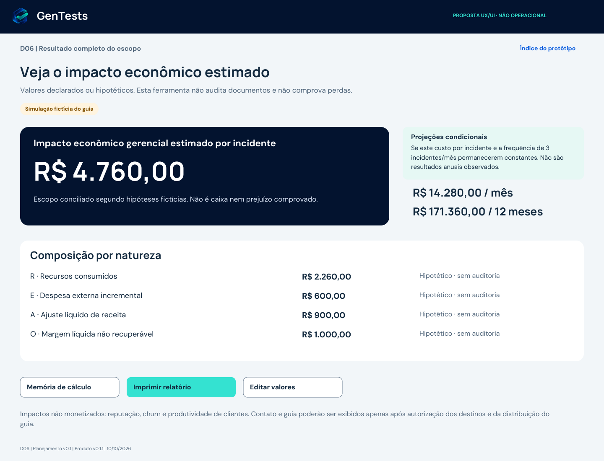
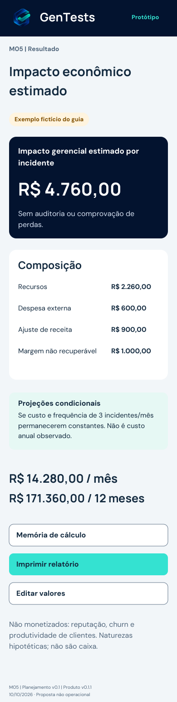
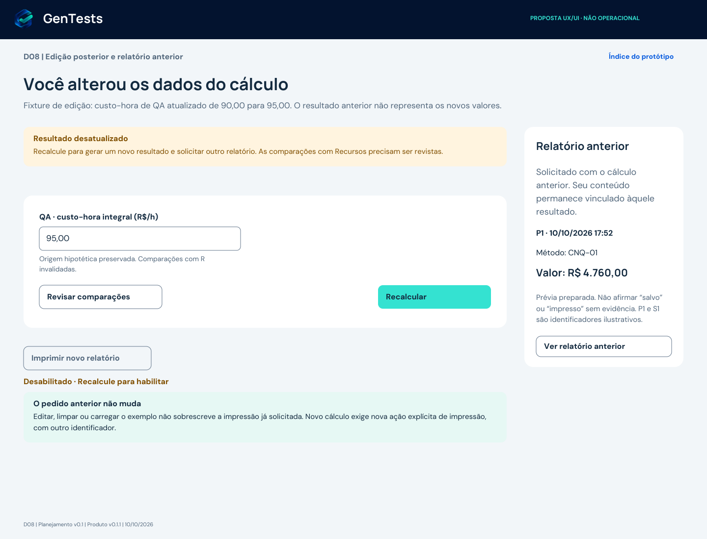
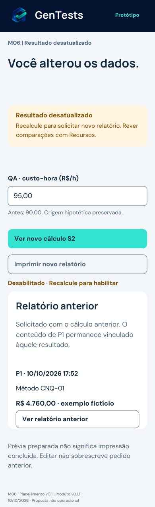

# Proposta UX/UI - Calculadora de Custo da Não Qualidade

**Proposta visual para deliberação. Não é implementação nem homologação.** Fase 1: cálculo local, sem cadastro, memória de cálculo e impressão. Sem e-mail, captura de leads, telemetria ou mudança no site. As regras financeiras da especificação não foram alteradas.

## 1. Base e segregação de funções

- [Especificação de Produto - PR #28](https://github.com/gentestsai-sudo/gentests-os/pull/28), commit `8df9e2f16019be3095ca7ab2bfe69c2ca94d6d8c`.
- [Interface-Jornada.md no commit validado](https://github.com/gentestsai-sudo/gentests-os/blob/8df9e2f16019be3095ca7ab2bfe69c2ca94d6d8c/produtos/GT-PROD-CNB-001/Interface-Jornada.md).
- Especificacao-Funcional.md e Aceite-Testes.md no mesmo commit: RF-01-04, IN-01-15, RN-01-11, 34 CA e oito CF preservados.
- [Revalidação independente - PR #31](https://github.com/gentestsai-sudo/gentests-os/pull/31): encerramento documental; não aprovação da interface futura.
- [Decisão #33](https://github.com/gentestsai-sudo/gentests-os/issues/33): somente planejamento técnico e estimativa autorizados. O pedido específico de UX/UI autoriza esta prototipação não operacional.
- Identidade consultada em `gentestsai-sudo/gentests-site`, commit `fe4af7cd49f4d7446feb27519ec4f427e1c2c399`: index.html, styles.css e assets/icone-gentests.png. CSS blob `8f93eac28695abbd9536bcac9112c3e08a0a3747`. Manrope, DM Sans, azul #04132F e turquesa #34E2D1 observados. Símbolo oficial reutilizado, sem recriação; bytes obtidos do ativo https://gentests-site.pages.dev/assets/icone-gentests.png em 10/10/2026. A equivalência binária com o arquivo no commit do repositório não foi verificada; o manifesto identifica os bytes efetivamente usados.
- Fonte de acessibilidade: [W3C WCAG 2.2](https://www.w3.org/TR/WCAG22/), consultada em 10/10/2026. As recomendações abaixo são planejamento, não declaração de conformidade.

Autor: propõe e verifica seus artefatos. Revisor independente: avalia a proposta visual e a aderência focal, sem confundir com repetição da auditoria documental encerrada. Direção: delibera design, prioridade, capacidade, teto de horas e eventual autorização específica. Cada ato permanece separado. PR de Produto #28 continua aberta/Draft, sem merge.

## 2. Entregáveis e como revisar

| Arquivo | Finalidade |
|---|---|
| GT-PROD-CNB-001-Prototipo-UX-v0.1.pdf | 29 pranchas, navegação interna por links e marcadores; desktop, mobile, wireframes, estados e prévias A4 |
| pranchas/*.svg | 29 desenhos vetoriais editáveis, sem scripts, eventos ou cálculos |
| Mapa-Prototipo.json | IDs, dimensões, páginas e destinos da navegação documental |
| Contrastes.json | 12 combinações sólidas medidas, com razões de contraste |
| Preview-Desktop.png / Preview-Mobile.png | Prévia visual do resultado do exemplo fictício |
| assets/ | Símbolo oficial, fontes estáticas para reproduzir o desenho e licenças OFL |
| SHA256SUMS.txt | Integridade dos arquivos finais do pacote, exceto o próprio manifesto |
| README.md | Jornada, componentes, estados, acessibilidade, esforço, riscos e plano de revisão |

Abra o PDF em leitor que suporte links internos, começando pelo índice. No mobile, tocar em “Protótipo” retorna ao índice. Alguns previews podem ignorar links; nesse caso, usar os marcadores/páginas e Mapa-Prototipo.json. As áreas de campo não recebem dados: todos os valores são fixtures fixas. Botões mudam a página do documento; não calculam ou imprimem por si.

Os SVGs podem ser abertos em editor vetorial sem contratação de ferramenta, mantendo a pasta assets junto de pranchas e instalando as fontes fornecidas. O PDF incorpora as fontes e o símbolo, sendo a referência visual canônica. Os SVGs usam referências locais ao símbolo para evitar duplicação. Fontes estáticas derivadas das famílias OFL; licenças incluídas. Sem serviço de design externo, conta paga ou hospedagem.

## 3. Direção de experiência

Público: CTOs, líderes de engenharia/produto/qualidade e gestores sem formação financeira. Objetivo imediato: organizar uma estimativa útil sem pressupor que todo impacto é mensurável. A precisão metodológica é um elemento de confiança comercial, não um obstáculo escondido no rodapé.

Quatro etapas: **Esforço → Efeitos distintos → Recorrência → Revisão**. Resultado e memória são destinos posteriores, sem impor cadastro. Campos desconhecidos permitem seguir, com exclusões claras; a jornada não exige inventar números para completar o formulário. Valores e estados permanecem ao navegar. Não prometer preenchimento em número fixo de minutos antes de pesquisa de uso.

Desktop: formulário e resumo em duas colunas, com largura fluida e conteúdo expandível. O resumo pré-cálculo mostra valores em revisão, sem total pronto. Mobile: uma coluna, campos empilhados, resumo depois do preenchimento. Sem painel sticky ou barra de ação sobreposta ao conteúdo. Layout alvo 1440 px e 390 px; reflow futuro também em 320 px. Alturas das pranchas são recortes de documentação, não limites fixos de componente.

Títulos e avisos explicam a tarefa. Ajuda aparece junto do campo, não apenas em tooltip. Sem contadores animados, gráfico alarmista, ranking de perdas, ROI ou benchmark. A tabela por natureza permanece legível mesmo se futuramente houver gráfico complementar.

## 4. Inventário e fluxo do protótipo

| IDs | Conteúdo | Referências principais |
|---|---|---|
| INDICE / WF | Escopo do protótipo e wireframes desktop/mobile | Interface-Jornada §§1-2 |
| D01 / M01 | Inicial vazio, sem resultado, exemplo por ação explícita | RF-01/02, CA-01/05 |
| D02 / M02 | Dev, QA e suporte; operação opcional; horas e taxas do exemplo | IN-02-06, RN-02, CA-02/07/13 |
| D03F | Entrada de E/A/O, origem e ajuda financeira | IN-07-10/14, RN-10/11 |
| D03 / M03 | Comparação contextual de cada par e origens atuais | RN-09a, CA-06/08/18, CF-01-03 |
| D04 / M04 | Frequência opcional, hipótese constante, contexto de downtime | IN-11-13, RN-05/11, CA-09/10/14, CF-08 |
| D05 / M07 | Erro de formato, resumo e correção; comparação pendente | RN-01/09, CA-11/12/19 |
| D05V | Revisão válida e cálculo explícito | RF-03, CA-02 |
| D06 / M05 | Resultado completo do escopo: R$ 4.760,00 | RN-03-06, CA-02/18 |
| D07 / M08 | Subtotal R$ 2.860,00; A/O excluídos | RN-07-09a, CA-06, CF-01 |
| D08 / M06 | Edição, resultado desatualizado, pedido anterior separado | RF-04, CA-16/21, CF-03/04 |
| D08V | S2 fictício após taxa de QA 95,00: T=4.790, M=14.370, Y=172.440 | Mesmas fórmulas, sem alterar exemplo canônico |
| D09 | Memória, proveniência, arredondamento e limites | RN-02-08, CA-13/18/21 |
| R01/R03 | Relatório A4 de S1 completo | RF-04, CA-21, CF-04 |
| R02/R03 | Alternativa A4 incompleta, A/O excluídos | RN-07/09, CA-06/21 |
| R04/R05 | Relatório A4 de S2, ilustrando outro pedido P2 | RF-04, CA-16/21, CF-04 |
| ESTADOS / TOKENS | Componentes, estados, sistema visual | CA-03/17/19/20 |

Fluxo principal desktop: INDICE → D01 → D02 → D03F → D03 → D04 → D05V → D06 → D09 → R01/R03. D05 é uma ramificação de erro, não etapa inevitável. D03F mostra estimativa própria vazia; seu botão de protótipo abre deliberadamente a fixture fictícia D03. Na UI futura, confirmar substituição se houver dados próprios e manter origens corretas.

Fluxo mobile: M01 → M02 → M03 → M04 → M05 → relatório. M04 reúne visualmente recorrência/revisão para documentação; na UI futura continuam etapas separadas. Componentes de QA/suporte repetem o padrão de M02, não desaparecem do produto. M07/M08 ilustram erro/subtotal e M06 a edição. R01/R02/R04 e a memória são documentos responsivos a especificar, não páginas desktop obrigatórias para o visitante mobile.

P1/S1 em R01 e R02 representam cenários alternativos; não são o mesmo pedido operacional com conteúdos diferentes. P2/S2 demonstra a solicitação nova após edição. Datas e identificadores exibidos são fictícios. R03 compara memórias alternativas para revisão visual; na implementação futura, um pedido imprime apenas sua memória, sem alternar snapshots. Nenhum request_id ou hash operacional foi criado.

## 5. Contrato de componentes e estados

| Componente/estado | Comportamento futuro especificado |
|---|---|
| Grupo de entrada | Seletor nativo de estado/origem: informado, hipotético, desconhecido, não aplicável. Valor e origem nunca inferidos pela presença de texto |
| Campo de moeda/horas | Label visível com unidade. Aceitar pt-BR conforme RN-01; teclado decimal é auxílio, não validação. Sem máscara que corrija silenciosamente ponto, expoente, negativo ou agrupamento inválido |
| Campo vazio | Estado desconhecido. Não preencher salário, frequência ou médias de mercado |
| Zero informado | Mostrar 0,00 e origem. Horas=0 não exigem taxa; taxa=0 com horas>0 exige “custo zero informado”. R$0,00 não significa ausência de todo impacto |
| N/A | Escolha explícita; motivo de exclusão de escopo no resultado/relatório. Não contabilizar como zero mensurado |
| Horas únicas | Por grupo: “Estas horas já estão sem repetição?” Sim/Não sei. Não sei exclui o grupo. Operação opcional usa o mesmo componente e limite, sem papel/salário novo |
| Efeitos E/A/O | Uma rubrica por natureza. Referência local gerada/selecionada; sem campo livre para cliente, pedido real, pessoa ou comprovante. Agregações externas são responsabilidade declaratória do usuário |
| Comparação | Um fieldset por par, mostrando naturezas, valores, origens e referências atuais. Respostas: distinto / sobreposto / não sei / parcela incremental distinta |
| Incremental distinta | Explicar conciliação externa e editar os campos existentes para conter só valores não sobrepostos. Mostrar quais naturezas/valores foram comparados; não criar outra rubrica |
| Falta de resposta / origem desconhecida | Excluir efeitos envolvidos. Não confirmar automaticamente por referências diferentes ou checkbox global. Mostrar quem foi excluído, por quê, e subtotal incompleto |
| Erro monetário | Resumo com links + mensagem junto do campo + texto de correção. Sem resultado novo até corrigir. Preservar todos os outros valores |
| Contexto >744h | Rejeitar sem truncar, manter contexto não informado. Explicar limite da ferramenta, sem dizer máximo real; não bloquear parcelas monetárias válidas |
| Todos desconhecidos/N/A | “Informe ao menos uma parcela”. Sem resultado monetário. Todos zeros explícitos: resultado zero para parcelas consideradas |
| Frequência ausente / zero | Ausente: projeções “não calculável”. N=0: projeções zero sob a hipótese, preservando custo por incidente. Não arredondar frequência fracionária |
| Validando/calculando | Status textual moderado; sem anúncio a cada digitação, sem spinner artificial. Desabilitar apenas repetição da ação em processamento se necessária |
| Edição após resultado | Marcar desatualizado imediatamente; invalidar comparações afetadas; bloquear novo relatório até recalcular. Não esconder aviso abaixo da dobra |
| Pedido de impressão | Congelar snapshot, versões, exclusões e hash antes de paginar; request_id próprio. Status separado: preparando/prévia preparada/erro ao preparar. Abrir diálogo não prova salvar ou imprimir |
| Edição durante impressão | Pedido anterior mantém snapshot original; mostrar “Relatório solicitado com o cálculo anterior”. Novo cálculo e pedido explícito geram novos identificadores |
| Limpar/substituir | Diálogo de confirmação se preenchido, com Cancelar e Limpar/Substituir; foco no cancelamento por padrão. Cancelar preserva os valores. Não modifica impressão já solicitada |
| Falha de impressão | Manter resultado válido e sua memória. Permitir revisar o relatório acessível; nova solicitação é explícita, sem reaproveitar pedido com dados diferentes |

Mudanças em valor, origem, estado, referência ou relação invalidam comparações afetadas. Alterar Recursos invalida comparações com R. No exemplo do guia, confirmações são hipóteses fictícias e nunca confirmações financeiras auditadas.

## 6. Sistema visual e acessibilidade

Tokens propostos, sem CSS implementado:

| Papel | Definição |
|---|---|
| Marca | Símbolo oficial; azul #04132F; turquesa #34E2D1 |
| Superfície de formulário | Branco #FFFFFF sobre fundo #F3F6FA; texto #142B3F; secundário #52677D |
| Ação/link e foco claro | #075BDF; evitar link distinguido somente pela cor: sublinhado/estilo contextual e label claro |
| Aviso | Texto #805000 sobre #FFF5DF, com título explicativo |
| Erro | Texto/borda #B42332 sobre #FFF0F1, mais texto de identificação e sugestão |
| Borda de controle | #64788D: 4,55:1 sobre branco, 4,20:1 sobre #F3F6FA |
| Foco | Contorno externo 3px, afastamento 3px; azul em claro, turquesa em azul escuro. Deve ser visível e não oculto |
| Tipografia | Manrope 700 nos títulos; DM Sans 400/700 em corpo, campos e valores; números tabulares no produto futuro |
| Tamanhos | Título desktop 34px, mobile 28-30px; corpo 16-18px, entrelinha 1,5; ajuda 14-15px; valores fluidos sem altura fixa |
| Espaçamento | Escala 4/8/12/16/24/32/48/64px; margem desktop 48px, mobile 20px; controles 48px, área de toque ao menos 44×44px |
| Raios | Campo 8px; botão 10px; painel 16-20px. Sem overflow que esconda conteúdo relevante |

Contrastes sólidos medidos: corpo/branco 14,51:1; secundário/branco 5,84:1; link/branco 5,88:1; texto/botão turquesa 8,95:1; branco/azul 18,43:1; aviso 6,32:1; erro 5,88:1. Todas essas combinações de texto excedem 4,5:1. Não usar turquesa como texto sobre branco. Medição de tokens não demonstra foco, estados reais ou conformidade do produto.

| WCAG 2.2 AA / critério relacionado | Recomendação e verificação futura |
|---|---|
| 1.3.1 / 1.3.2 | Labels, grupos e hierarquia semânticos; tabela/lista de resultados em ordem de leitura; não simular tabela apenas com posicionamento visual |
| 1.4.1 / 1.4.3 / 1.4.11 | Texto explica erro/estado; contraste ≥4,5:1 para corpo e ≥3:1 para texto grande/controles aplicáveis; medir todas as variantes |
| 1.4.4 / 1.4.10 / 1.4.12 | Zoom 200%/400%, reflow 320 CSS px e espaçamento de texto; valores extensos e linhas de relatório sem corte ou rolagem horizontal do formulário |
| 2.1.1 / 2.1.2 | Toda tarefa por teclado; sem armadilha; controles nativos quando adequados |
| 2.4.3 / 2.4.7 / 2.4.11 | Foco previsível, visível e não encoberto. Ação de Calcular com erro anuncia resumo e leva ao primeiro campo inválido; links do resumo permitem retornar a cada erro |
| 2.5.3 / 2.5.8 | Nome acessível inclui texto visível; alvos de 44×44 propostos. O mínimo AA de 2.5.8 é 24×24 com exceções; 44×44 é escolha de usabilidade, não requisito geral AA |
| 3.1.1 / 3.2.2 / 3.3.1-3 | pt-BR, sem navegação inesperada ao editar; erros específicos e sugestões; revisar antes de substituir dados |
| 4.1.2 / 4.1.3 | Nomes/papéis/estados; erros associados via aria-describedby; status moderado em live region; valores não anunciados tecla a tecla |

Planejar VoiceOver/Safari e NVDA/Firefox ou Chrome, além de teclado e automação. Retorno do diálogo de confirmação ao disparador. Sem dependência de áudio, CAPTCHA visual, movimento, hover ou cor. Testes automáticos ajudam e não certificam AA. Layout A4 aqui é visual; relatório HTML acessível será alternativa canônica futura. “Salvar como PDF” não assegura PDF/UA. O protótipo PDF/SVG não é certificado WCAG nem substitui esses testes.

## 7. Resultado e impressão

- Completo do escopo: “Impacto econômico gerencial estimado por incidente”. Origem, natureza e ausência de auditoria junto do valor. Nunca “prejuízo comprovado”, “economia garantida” ou “custo total da empresa”.
- Incompleto: “Subtotal estimado - estimativa incompleta”; quantidade/motivos de exclusão, projeções somente das parcelas incluídas.
- Mês/12 meses: sempre condicionados a T e N constantes; ausência de frequência não é zero.
- Memória: R por bloco com operandos/origem, soma R/E/A/O elegíveis, arredondamento, projeções, exclusões/N/A e impactos não monetizados.
- Impressão: preto/texto escuro, fundo branco, corpo proposto 11-12pt, A4 com margens de 12-16mm, cabeçalho repetível em tabelas, páginas numeradas e quebra entre linhas. Prévia R01/R02/R04 mostra o conteúdo principal; R03/R05 demonstra memória e limites. A versão futura pode expandir a mais páginas: não comprimir texto para caber em duas.
- Controles de navegação do protótipo, rótulo “Protótipo” e notas de documentação não são conteúdo obrigatório do relatório futuro. A UI futura deve esconder seus controles na impressão.
- Cada página operacional deve referenciar o mesmo pedido/snapshot. Incluir request_id, data, schema_version, product_version, methodology_version, versão do guia e snapshot_hash completos em bloco técnico acessível, sem tratar hash como assinatura ou prova de perdas. Os valores de tais campos dependem do contrato de produto; não inventados neste mockup.
- Em Fase 1, nenhuma ação de “Receber por e-mail”, consentimento de marketing ou captura. Convite voluntário para metodologia/contato somente com destinos aprovados; não inserir oferta/preço novo.

## 8. Estimativa detalhada de esforço futuro

Hipóteses para decisão, não orçamento ou prazo aprovado. Horas-pessoa; um incidente, quatro blocos máximos de esforço, três efeitos, seis pares máximos de conciliação. Reutilizar stack/ativos existentes; sem backend, e-mail, persistência, telemetria, autenticação ou PDF por servidor. O autor não iniciou nenhuma das atividades de implementação estimadas.

| Atividade futura | Faixa (h) | Dependência / saída |
|---|---:|---|
| Handoff focal e ajuste após revisão | 4-6 | Aceite visual; microcopy/componentes fechados; sem alterar método |
| Motor/entradas/proveniência e testes unitários de vetores | 6-10 | Regras/limites validados; parsing pt-BR, centavos e half-up |
| Interface progressiva e componentes responsivos | 10-16 | Handoff; origem, campos, foco, navegação e confirmação |
| Conciliação contextual e invalidação por edição | 6-10 | Motor + grupos; seis pares e exclusões com motivos |
| Resultado, projeções e memória | 3-5 | Parcelas elegíveis; completo/incompleto e estado desatualizado |
| Snapshot e relatório local imprimível | 4-7 | Contrato RF-04; paginação imutável e pedido anterior |
| QA funcional, visual, acessibilidade e impressão | 10-16 | Build autorizado; critérios Fase 1, dispositivos/leitores e evidências |
| Revisão independente do build/evidências | 3-5 | Commit exato e evidências de QA; não é a revisão documental já encerrada |
| Correções e reteste focal | 3-6 | Achados da futura execução; sem rodada geral automática |
| **Total Fase 1 até decisão de lançamento** | **49-81** | Sem tempo de espera por gates, comercial ou publicação |

**Núcleo de desenvolvimento: 29-48h** (cinco linhas motor → impressão), refinando a hipótese anterior 28-48h. O total maior inclui handoff, validação, revisão e correções que não cabiam na hipótese de núcleo. UI/resultados/relatório somam 23-38h desse núcleo, sem dupla contagem no total. QA de fluxo não repete as horas de unitários do motor. Faixa de correção é contingência explicitada, não reserva além do total.

Cronograma indicativo se aprovado e com dedicação efetiva de 6h/dia: desenvolvimento 5-8 dias úteis; pacote completo 9-14 dias úteis, mais esperas da Direção/revisor. Trabalho parcial, interrupções de vendas e ausência de dispositivos podem alongar duração. Não usar divisão de horas como compromisso de entrega.

Custo de ferramenta de prototipação: R$0 incremental nesta entrega. Fase 1 proposta sem serviço pago adicional; disponibilidade/cotas/configuração do ambiente deverão ser confirmadas antes de deploy. Mão de obra não é gratuita por usar ferramentas gratuitas. Sem custo-hora aprovado, custo monetário é **49-81 × taxa acordada**, não valor fechado. Sem contratação, domínio ou despesa autorizada.

Recomendação: usar a aprovação deste desenho para fechar um teto de esforço e a posição da calculadora frente à conquista dos primeiros clientes. Caso 49-81h não caibam na capacidade, adiar implementação. Não economizar retirando conciliação, memória, acessibilidade, revisão ou distinção entre estimativa e perdas. Não ativar Fase 2 para tornar a Fase 1 comercialmente atraente.

## 9. Riscos e ações propostas

| Risco / prioridade | Evidência de risco no desenho | Mitigação antes/futuramente |
|---|---|---|
| Conciliação cognitivamente pesada / alta | Até seis comparações, termos financeiros e origens | Mostrar par atual e panorama; exemplos em linguagem simples; não automatizar confirmação. Ensaio de tarefas com 3-5 representantes, com recursos e autorização próprios antes de recrutamento |
| Total parecer prejuízo comprovado / alta | Valor destacado pode dominar os avisos | Microcopy junto do valor e no relatório; natureza/origem; revisar entendimento com usuários; sem ROI/benchmarks |
| Subtotal parecer total integral / alta | Parcelas desconhecidas podem ser ignoradas | Badge incompleto e quantidade/motivos de exclusão antes de projeções; R$0 explícito diferente de desconhecido |
| Mistura de snapshot após editar / alta | Interface mantém resultado e pedido anterior | RF-04, novos relatórios bloqueados, testes CF-04; layout separa histórico de formulário |
| Mobile longo / média | Campos por grupo e comparações empilhadas | Quatro etapas, ajuda concisa, preservar valores; mostrar progresso. Sem redução dos controles financeiros |
| Terminologia O/A / média | Gestor pode usar receita bruta como margem | Ajuda contextual; não sugerir margem padrão; explicar conciliação externa com financeiro |
| Layout quebrar com valores altos / alta | Até R$10 bilhões por incidente/R$1 trilhão anual | Largura fluida, quebra e tipografia responsiva; fixtures de limites/textos longos; nunca cortar símbolos/casas |
| Parsing/teclado mobile / média | Decimal pt-BR e ponto automático do teclado | Sugestão explícita; teclado decimal opcional; teste iOS/Android; sem normalização silenciosa |
| Acessibilidade só visual / alta | PDF mostra aparência, não semântica/teclado | Testes manuais, leitores de tela e reflow na UI real; evidência de cada critério relevante |
| Impressão/cópia local e privacidade / média | Relatório pode conter valores internos | Sem pessoas/anexos/URL com valores; explicar perda ao fechar aba e responsabilidade por cópia/impressora compartilhada; revisão de privacidade antes de publicar |
| Prioridade comercial / alta | Esforço total supera hipótese apenas do núcleo | Teto e prioridade explícitos; não desviar capacidade comercial por iniciar desenvolvimento sem decisão |

Os ensaios com usuários são recomendação futura, não pesquisa já executada e não contato autorizado com terceiros.

## 10. Plano de verificação e limites desta entrega

Esta entrega verificou **artefatos de design**, não funcionamento do produto: renderização das 29 pranchas do PDF, inspeção visual desktop/mobile/relatório, presença das fontes, integridade dos arquivos e enlaces internos, medição de 12 pares de contraste. Pranchas foram examinadas com captura de renderização; ajustados espaçamentos e leitura do resumo lateral. Nenhum CA/CF recebeu status “passou” por ter sido desenhado.

| Critérios/cenários originais | Planejamento Fase 1 |
|---|---|
| CA-01-18 | Vetores/entradas, proveniência, exclusões, contexto, limites, atualização e substituir/limpar; cada CA original mantém sua referência |
| CA-19-21 | Teclado/leitores, layouts 320/375/768/1280, zoom/textos longos e impressão multipágina |
| CA-22 | Sem e-mail, cálculo/memória/impressão disponíveis; fluxo de envio fora da fase |
| CA-23-27 | Dependem de Fase 2: não executáveis no escopo Fase 1; não marcar “passou” |
| CA-28 | Conferir ausência de transmissão/storage/logs de dados da simulação no núcleo local; nenhum analytics por esta fase |
| CA-29 | Sem telemetria ativada; dedupe operacional futuro onde aplicável; não afirmar que abrir print comprova salvar |
| CA-30-32 | Metodologia/FAQ sem JS, performance/compatibilidade e gates; homologação sem publicação/indexação liberada |
| CA-33-34 | Reabertura com só esforço novo; degradação/rede/browser e mensagem honesta sem JS |
| CF-01-04 e CF-08 | Comparações, edição, impressão congelada e limite contextual; futuro teste real obrigatório |
| CF-05-07 | Envio/idempotência/timeout dependem de autorização de Fase 2; preservados no documento, fora desta UI |

Futuro registro por teste: CA/CF, data/ambiente/dispositivo, commit, versão do método, fixture, esperado/obtido, status passou/falhou/não verificado/N/A justificado, captura sanitizada e executor. Testes em máquinas disponíveis sem cobrança não dispensam matriz de cobertura; limitações serão registradas. A revisão visual desta proposta não prova AA, segurança, precisão do motor, reflow real, desempenho ou impressão em navegadores.

## 11. Pontos de decisão

1. Aceitar ou ajustar a direção visual e a sequência progressiva.
2. Confirmar teto de horas, capacidade e prioridade comercial, avaliando a faixa 49-81h.
3. Designar revisão independente desta proposta visual e da futura implementação, em atos separados.
4. Validar contrato de versões do método/guia e identificadores do relatório antes do desenvolvimento; distribuição do guia/link continua com gate próprio.
5. Após essas decisões, emitir autorização expressa separada de implementação. Publicação e merge continuam exigindo gates próprios.

**Estado final: proposta UX/UI entregue para revisão e deliberação; implementação, publicação e merge não autorizados.**

## 12. Rodada focal única - REV-PROD-CNB-003

Base da correção: [parecer independente PR #37](https://github.com/gentestsai-sudo/gentests-os/pull/37), documento `revisoes/REV-PROD-CNB-003-Parecer-UX-UI-Focal.md`, commit do parecer `b1e2acbe58a9e5b43e7b0f7ff84d98ae1de49c6c`, sobre a proposta `1656257d8ba84ac643aa96926cb35208ce0bf1fd`. Resultado anterior preservado: **aprovado com ressalvas para deliberação de planejamento**. O autor trata os achados; não atribui fechamento independente nem aprovação visual da Direção.

### Matriz objetiva de tratamento

| Achado / severidade | Ajuste realizado | Evidência / estado |
|---|---|---|
| CNB-UX-REV-01 / média | D08 e M06 conservam botão cinza sem destino de navegação, com texto adjacente **“Desabilitado · Recalcule para habilitar”**. Adicionado acesso explícito **“Ver relatório anterior”** ao pedido fictício P1/S1. PDF e mapa documental refletem os mesmos estados | [D08.svg](pranchas/D08.svg), [M06.svg](pranchas/M06.svg), [evidência desktop](Evidencia-D08-CNB-UX-REV-01.png) e [evidência mobile](Evidencia-M06-CNB-UX-REV-01.png). Tratado pelo autor; encerramento independente pendente de revalidação exclusivamente deste achado |
| CNB-UX-REV-02 / baixa | Handoff abaixo define posição/progresso real das comparações, lista de pendentes, expansão e navegação em mobile. M03 preservada, sem novas pranchas | Complementação documental de handoff nesta seção. Tratado; sem nova rodada formal de revisão |
| CNB-UX-REV-03 / baixa | Handoff abaixo exige medir componentes e estados reais, distinguir controle ativo/desabilitado e testar critérios AA aplicáveis. Tokens permanecem referência preliminar | Complementação documental de handoff nesta seção. Tratado; sem nova rodada formal de revisão. Nenhuma conformidade WCAG declarada |

### CNB-UX-REV-01 - impressão e pedido anterior

O texto “Imprimir novo relatório” continua visível para explicar a ação futura, mas sua indisponibilidade agora é inequívoca no desenho desktop/mobile. O botão é representado desabilitado, sem área clicável no PDF; o aviso “Recalcule para habilitar” está imediatamente abaixo. O acesso ao relatório já solicitado continua separado e disponível, vinculado a S1, mesmo quando os campos editados aguardam recálculo. Na implementação futura, atribuir estado desabilitado nativo e associar a explicação ao controle. Não simular apenas com aparência ou bloquear o acesso ao pedido anterior.

D08/M06 mantêm os mesmos valores editados (QA 95,00), resultado anterior (4.760,00) e fluxo S1/S2. Recalcular continua exigindo revisão das comparações afetadas. O link do relatório anterior é navegação do protótipo documental; não cria impressão real. CF-03/04 e RF-04 permanecem intactos.

### CNB-UX-REV-02 - conciliação em telas pequenas

- Exibir, junto ao título do par ativo, a **posição na lista**, por exemplo “Comparação 1 de 6”. Separadamente mostrar o progresso de respostas válidas, por exemplo “1 de 6 comparações avaliadas; 5 pendentes”. A posição não significa conclusão.
- Derivar a quantidade dos pares candidatos existentes e elegíveis no estado atual; seis é o máximo de R/E/A/O, não constante imposta quando alguma natureza for N/A ou não existir. Valores desconhecidos ou relações sem resposta não contam como conciliação concluída. “Sobreposto” pode ser resposta registrada, mas mantém as exclusões: responder não significa tornar a parcela incluída.
- Mostrar lista textual de pares, com estado **pendente**, **avaliado**, **sobreposição**, **não sei** ou **revisão necessária após edição**. Exemplos de rótulos: “E ↔ R - pendente” e “A ↔ O - não sei; parcelas excluídas”. Manter os identificadores das naturezas e nomes compreensíveis. Referências distintas não mudam o estado por si.
- O usuário pode expandir um par por vez para leitura confortável, sem limitar a abertura de outro ou exigir uma sequência rígida. No par expandido, natureza, valor, origem e referência dos dois lados ficam empilhados e visíveis simultaneamente. Nunca esconder um dos lados em carrossel, aba ou rolagem horizontal.
- Um controle de expansão mostra nome do par, estado e indicador expandido/recolhido. Na futura UI, usar disclosure nativo ou botão com aria-expanded e relação com o painel; espaço de toque ao menos 44×44px. Disponibilizar “Próxima comparação” e a lista de pendências; retornar a um par não apaga respostas.
- Ao abrir outro par por ação explícita, levar o foco ao cabeçalho/painel pertinente sem saltos automáticos enquanto se digita. Ao editar valores/origens/referências, invalidar comparações afetadas, atualizar a lista e anunciar apenas o status relevante, sem declarar ausência de duplicidade.
- A fixture M03 continua ilustrando A ↔ O; o progresso real e a lista completa são contrato de handoff para implementação futura. A simulação fictícia mantém relações como hipóteses rotuladas; não as transforma em confirmações auditadas do usuário.

### CNB-UX-REV-03 - contraste e estados dos componentes reais

Durante a implementação futura, medir os componentes renderizados em seus fundos efetivos, considerando borda, preenchimento, rótulo, ícone, indicador de seleção, aviso e contorno de foco. Cobrir **padrão, foco, hover, erro e desabilitado**, inclusive combinações como erro com foco, e registrar valores obtidos, ambiente, captura e critério aplicável. Considerar temas/backgrounds adjacentes e configurações de alto contraste quando disponíveis.

Os 12 pares de `Contrastes.json` são somente tokens sólidos preliminares. Não demonstram todos os estados, interação, semântica, legibilidade, tamanho de alvo ou conformidade da calculadora. Preservar os valores do arquivo; nenhuma aprovação WCAG se baseia exclusivamente neles.

Verificar os critérios aplicáveis, especialmente 1.4.1 (cor), 1.4.3 (contraste de texto), 1.4.11 (contraste não textual), 2.4.7 (foco visível), 2.4.11 (foco não oculto), 2.5.8 (tamanho de alvo) e 4.1.2 (nome/papel/estado), além de reflow e leitura já previstos no §6. Usar pelo menos 4,5:1 em texto normal e 3:1 em texto grande/elementos não textuais quando aplicável. Componentes inativos têm exceções de contraste nos critérios pertinentes; isso não dispensa distinguir visualmente o estado desabilitado de uma ação habilitada e manter **a orientação explicativa legível**. Hover não pode ser a única forma de descobrir estado ou ajuda; foco deve funcionar por teclado.

### Evidências e preservação focal

Conferência desta rodada limitada a D08/M06 e às complementações de handoff. Nenhuma auditoria visual integral das 29 pranchas reaberta. As 27 outras pranchas SVG, previews de resultado, tokens/contrastes, fontes e símbolo foram preservados byte a byte em relação ao pacote revisado. Conteúdo dos demais quadros do PDF foi comparado com a base apenas para confirmar preservação, sem nova revisão visual; o PDF foi recomposto para incorporar as duas correções.

O mapa conserva os mesmos 29 IDs/dimensões, acrescentando somente dois destinos explícitos para a prévia do relatório anterior. A matriz financeira, a jornada, os 34 CA, os oito CF, o escopo gratuito, a identidade e a estimativa não foram alterados. Testes de produto, leitor assistivo, browser/mobile real e conformidade AA continuam não executados.

Encaminhamento: **revalidação independente exclusivamente de CNB-UX-REV-01**, para seu encerramento focal se necessário; os apontamentos baixos ficam tratados no handoff sem nova rodada formal. Direção delibera a aprovação visual depois, sem autorização automática de desenvolvimento/publicação. Manter PR #36 aberta/Draft, sem merge, site, contratação, cadastro, e-mail, telemetria ou leads.
